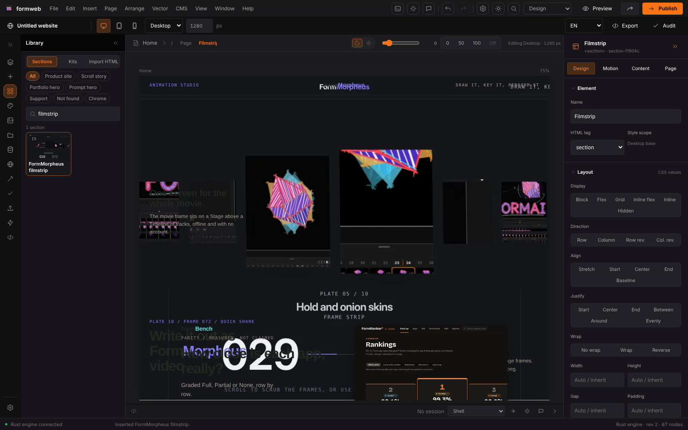
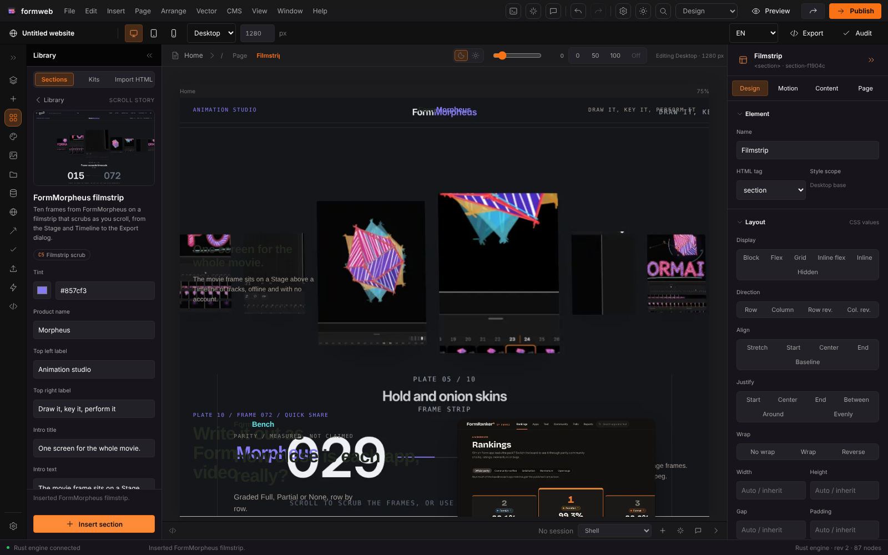

<p align="center">
  
</p>

<h1 align="center">FormWeb</h1>

<p align="center">
  <b>Website building; a visual editor for the Form family.</b><br>
  Pages, design systems, a CMS, a vector editor and static export,<br>
  driven by you or by your agents. Local-first, no account.
</p>

<p align="center">
  
  
  
  
  
  
</p>

<p align="center">
  <a href="https://formweb.formai.studio/"><b>Download FormWeb on formai.studio</b></a> ·
  <a href="https://github.com/nodemode-dev/formcompiler/releases?q=formweb-v&expanded=true">Latest release</a> ·
  <a href="#run-it-from-source">Run it from source</a>
</p>

<br>

<p align="center">
  
  <br>
  <sub>A small travel site open in the editor: layers, canvas and properties.</sub>
</p>

<p align="center">
  <a href="#features">Features</a> ·
  <a href="#everything-in-the-box">In the box</a> ·
  <a href="#built-for-agents">Agents</a> ·
  <a href="#under-the-hood">Under the hood</a> ·
  <a href="#download">Download</a> ·
  <a href="#run-it-from-source">Run from source</a>
</p>

<br>

<table>
  <tr>
    <td width="25%" valign="top"><h3>One engine</h3>A Rust engine owns the site, validation, history and static compilation, so every client edits the same document.</td>
    <td width="25%" valign="top"><h3>Real CMS</h3>Typed collections, bindings, detail routes, queries and exact CSV round trips live beside your pages.</td>
    <td width="25%" valign="top"><h3>Static export</h3>Compile portable HTML, CSS and runtime ZIPs, or publish local releases with promotion and rollback.</td>
    <td width="25%" valign="top"><h3>Agent-ready</h3>The same document is open to an MCP server and a command line, and agent edits show on the canvas at once.</td>
  </tr>
</table>

## Features

<table>
  <tr>
    <td width="50%" valign="top">
      
      <br><sub>The same page at 390 px, editing a mobile override.</sub>
      <h3>Responsive by breakpoint</h3>Switch between desktop, tablet and mobile and edit each override in place.
    </td>
    <td width="50%" valign="top">
      
      <br><sub>The audit lists issues you can jump straight to.</sub>
      <h3>SEO and accessibility audit</h3>Check meta descriptions, base URL and text contrast before you publish.
    </td>
  </tr>
  <tr>
    <td width="50%" valign="top">
      
      <br><sub>The Library panel, filtered by search, with the section inserted on the canvas.</sub>
      <h3>Section library</h3>Start from 35 animated, restylable sections, a design preset and a starter site, each inserted as one undo step.
    </td>
    <td width="50%" valign="top">
      
      <br><sub>Re-cast the tint, name and copy before you insert.</sub>
      <h3>Fields before insert</h3>Each section opens with the few fields a designer changes first; everything else is edited on the canvas.
    </td>
  </tr>
  <tr>
    <td width="50%" valign="top">
      <h3>Send to FormPublisher</h3>File > Send to FormPublisher exports the open site and hands it to FormPublisher on the same computer, live when it is running (found through its engine.json, so any port works) or into its inbox when it is not. Sending again files a new revision of the same site.
    </td>
    <td width="50%" valign="top">
      <h3>Agent tools for motion and the library</h3>16 MCP tools set motion and variables, build and place components, start a blank site, insert and re-cast library sections, and send the result to FormPublisher, each as one undo step.
    </td>
  </tr>
</table>

## Everything in the box

<table>
  <tr>
    <td width="33%" valign="top"><h4>Authoring</h4>Pages and layers · Flex and grid layout · Custom breakpoints · Design tokens · Components with variants and slots · Pen and shape tools · Pathfinder · Trace Image</td>
    <td width="33%" valign="top"><h4>Content and delivery</h4>CMS collections · Forms and inbox · Localized content and routes · JSON-LD · Redirects · Local releases · Signed webhooks · Review branches and comments</td>
    <td width="33%" valign="top"><h4>Formats</h4>Opens: <code>.fweb</code>, <code>.fpub</code> (from a FormWeb site), CSV, SVG, PNG, JPEG, WebP, GIF · Saves: HTML, CSS, JSON, ZIP · Native: <code>.fweb</code></td>
  </tr>
</table>

The editor runs in 26 languages, switched live in Preferences (Edit > Settings..., Ctrl+comma, or Cmd+comma on macOS).

A built-in library adds 35 section templates from the formai.studio sites, 21 first-party page components, a design-system preset, a product-site starter and Import HTML; see [docs/LIBRARY.md](docs/LIBRARY.md).

Three finished demo sites come with the app, on Home and under Help > Demos: Lowlight (a studio site made from library sections, with scroll scenes and animated components), Looking Back (a photo essay told in pinned scroll scenes, with a filterable gallery and a lightbox) and Harbour Ferries (a service site with a fare calculator, CMS route pages, site search and redirects). Each opens as a new, unsaved site to take apart, and Preview shows the finished site, every page, without replacing the site you are working on. Picture credits are in [frontend/public/demos/CREDITS.md](frontend/public/demos/CREDITS.md).

## Built for agents

One MCP server and one command line reach the same running document as the editor.

```sh
./formweb run --list                              # list the engine commands
./formweb run node.update id=headline 'patch={"text":"Hello"}'   # edit the open site
./formweb agents sync --check                     # check the skill mirrors and agents/manifest.json for drift
./formweb mcp                                     # MCP server on stdio for Claude Code, Codex, Cursor and Antigravity
./formweb library list scroll                     # find library sections (also: insert, preset, starter)
./formweb library insert formcut-proxy-monitor tint=#ff9a3c   # insert one, re-cast, as one undo step
```

Agents can also start a blank site, set native motion and variables, build and place page components, insert, re-cast and import library sections, and send the site to FormPublisher, and copy and paste an element between pages, with 16 authoring tools, `copy_element` and `paste_element` among them (103 MCP tools in all), described in [docs/ADVANCED_SCHEMA.md](docs/ADVANCED_SCHEMA.md).

`.mcp.json`, `.codex/config.toml` and `.cursor/mcp.json` are already wired in this repo. Start with the [agent quick start](docs/AGENT_QUICKSTART.md) and [`AGENTS.md`](AGENTS.md).

## Under the hood

- **Rust engine:** atomic commands, revisions, undo and redo, component propagation and the static compiler.
- **Python service:** FastAPI bridge for persistence, forms, local releases, HTTP and the official-SDK MCP server.
- **Vanilla TypeScript:** a Vite editor with one command registry behind every menu, button and shortcut.
- **Local data:** SQLite autosave and portable `.fweb` projects with history and assets; projects over 64 MiB save as a version 2 zip.
- **Editing:** Edit > Copy, Cut and Paste element (`Mod+C`, `Mod+X`, `Mod+V`) move an element with its motion, code, variables, design tokens, CMS collections and pictures between pages and sites (and, through 15-minute clip links for large pictures and videos, between FormWeb installations on the same computer), Edit > Duplicate element (`Mod+D`, or `Shift+Mod+D` always) copies it in place, and agents do the same with `copy_element` and `paste_element`; code components can carry a light-theme poster.
- **Tested:** backend tests in `backend/tests` and engine tests in `native/crates/*/tests`, run in CI.

## Download

| Platform | Download | Release |
|---|---|---|
| macOS | [Download FormWeb for macOS](https://formai.studio/get/formweb/macos) | [FormWeb releases on FormCompiler](https://github.com/nodemode-dev/formcompiler/releases?q=formweb-v&expanded=true) |
| Windows | [Download FormWeb for Windows](https://formai.studio/get/formweb/windows) | [FormWeb releases on FormCompiler](https://github.com/nodemode-dev/formcompiler/releases?q=formweb-v&expanded=true) |
| Linux | [Download FormWeb for Linux](https://formai.studio/get/formweb/linux) | [FormWeb releases on FormCompiler](https://github.com/nodemode-dev/formcompiler/releases?q=formweb-v&expanded=true) |

All FormWeb builds are compiled and released from [FormCompiler](https://github.com/nodemode-dev/formcompiler); this repo holds the source.

## Run it from source

Prefer it in your browser, or want to contribute? Run the web UI straight from this repo.

**Requires:** Node 22.12 or newer, Python 3.12 or newer, Rust stable and git.

```sh
git clone git@github.com:nodemode-dev/formweb.git
cd formweb
./formweb install   # builds the Rust engine, installs the backend venv and frontend packages
./formweb boot      # web UI at http://localhost:5240, API at http://127.0.0.1:8240
```

`./formweb build` then `./formweb serve` runs the compiled editor on http://127.0.0.1:8240. `./formweb doctor` checks your setup, and `./build_app` builds the desktop app.

On Windows use `formweb.bat install` and `formweb.bat boot`. The MCP endpoint is http://127.0.0.1:8240/mcp once Agents is enabled.

**Desktop shell on Linux.** Install the WebKitGTK packages, then build the shell:

```sh
sudo apt-get install -y libwebkit2gtk-4.1-dev libgtk-3-dev libayatana-appindicator3-dev librsvg2-dev libsoup-3.0-dev libjavascriptcoregtk-4.1-dev
cd src-tauri && cargo build --release   # about 6 minutes; binary at src-tauri/target/release/formweb
```

The [manual](docs/MANUAL.md#desktop-shell-on-linux) has the run steps and two WebKitGTK notes.

Settings live in `backend/.env` (see `backend/.env.example`): `FORMWEB_DATA_DIR`, `FORMWEB_CORE_BIN`, `FORMWEB_AGENTS`, `FORMWEB_AUTH_TOKEN`, `FORMWEB_PORT` and `FORMWEB_ORIGINS`. `FORMWEB_CLIP_SECONDS` (10 to 3600, default 900) sets how long a copy's clip link lives.

> [!IMPORTANT]
> **Status:** pre-launch. The Windows launchers and native desktop bundles are unverified, and provider adapters need server credentials. See the [Studio guide](docs/ADVANCED_GUIDE.md).

**Contributing:** branch from `main`, keep changes to source here, and leave packaging and releases to formcompiler. See [`CONTRIBUTING.md`](CONTRIBUTING.md), [`CODE_OF_CONDUCT.md`](CODE_OF_CONDUCT.md), [`.docs/BRANCHING.md`](.docs/BRANCHING.md) and [`AGENTS.md`](AGENTS.md). Report security issues privately as [`SECURITY.md`](SECURITY.md) describes.

## Repository

| Path | What it is |
|---|---|
| `native/crates/` | Rust model, engine, exporter, core process and GPU renderer |
| `backend/app/` | Process bridge, persistence, forms, local releases, HTTP and MCP |
| `frontend/src/` | The editor: canvas, layers, inspector and commands |
| `src-tauri/` | The desktop shell |
| `setup/` | Install, build, doctor, stdio proxy and skill mirroring |
| `docs/` | Manual, guides and parity comparisons |

Docs: [`.docs/wiki`](.docs/wiki) · Agents: [`CLAUDE.md`](CLAUDE.md), [`AGENTS.md`](AGENTS.md) · Contributing: [`CONTRIBUTING.md`](CONTRIBUTING.md), [`CODE_OF_CONDUCT.md`](CODE_OF_CONDUCT.md), [`SECURITY.md`](SECURITY.md), [`.docs/BRANCHING.md`](.docs/BRANCHING.md)

<br>

---

## Maintainers

| Maintainer | Role |
|---|---|
| [@nodemode-ai](https://github.com/nodemode-ai) | Owner |
| [@gbarnai](https://github.com/gbarnai) | Co-owner |

Code owners are set in [`.github/CODEOWNERS`](.github/CODEOWNERS).

## License

FormWeb is licensed under the Apache License 2.0 ([`LICENSE`](LICENSE), SPDX `Apache-2.0`). Copyright 2026 NodeAgentc, Inc. Third-party notices: [`NOTICE.md`](NOTICE.md), [`LICENSES.md`](LICENSES.md).

<sub>Screenshot content: CC0 photos from Poly Haven, cropped.</sub>

<sub>Framer is a trademark of Framer B.V. Webflow is a trademark of Webflow, Inc. Adobe and Illustrator are trademarks of Adobe. They are named only to describe what FormWeb was researched against; FormWeb is not affiliated with or endorsed by them.</sub>
