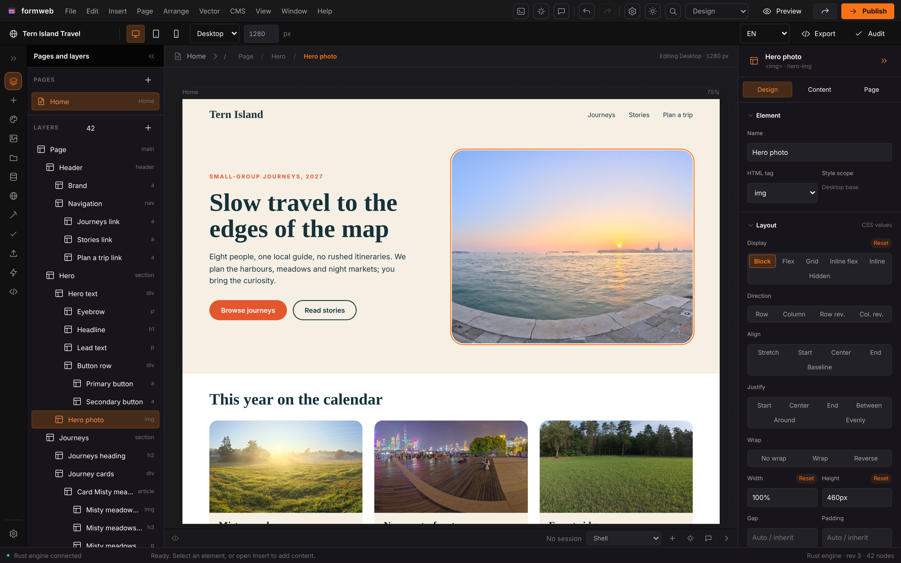
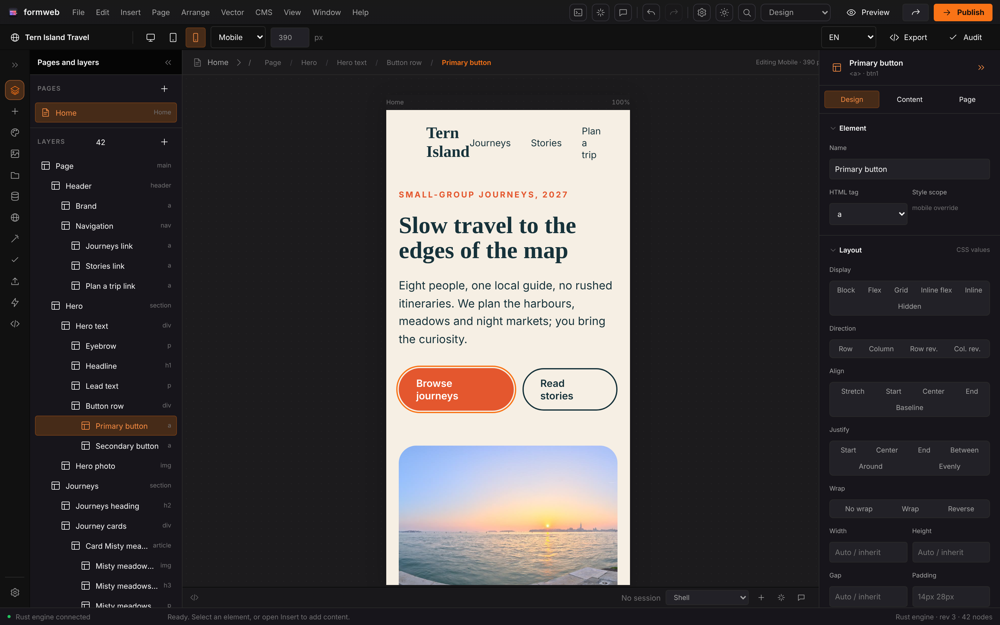
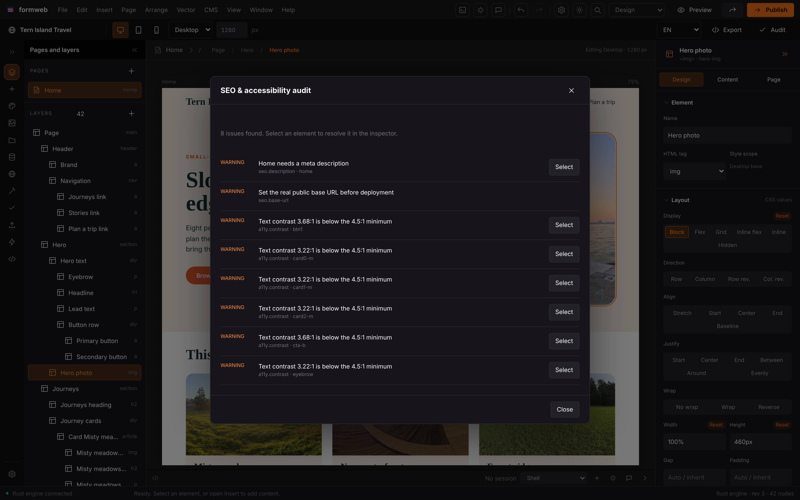

<p align="center">
  
</p>

<h1 align="center">FormWeb</h1>

<p align="center">
  <b>Website building; a visual editor for the Form family.</b><br>
  Pages, design systems, a CMS, a vector editor and static export,<br>
  driven by you or by your agents. Local-first, no account.
</p>

<p align="center">
  
  
  
  
  
  
</p>

<p align="center">
  <a href="https://formweb.formai.studio/"><b>Download FormWeb on formai.studio</b></a> ·
  <a href="https://github.com/nodemode-dev/formcompiler/releases?q=formweb-v&expanded=true">Latest release</a> ·
  <a href="#run-it-from-source">Run it from source</a> ·
  <a href="#the-form-family">All Form apps</a>
</p>

<br>

<p align="center">
  
  <br>
  <sub>A small travel site open in the editor: layers, canvas and properties.</sub>
</p>

<p align="center">
  <a href="#features">Features</a> ·
  <a href="#everything-in-the-box">In the box</a> ·
  <a href="#built-for-agents">Agents</a> ·
  <a href="#under-the-hood">Under the hood</a> ·
  <a href="#download">Download</a> ·
  <a href="#run-it-from-source">Run from source</a> ·
  <a href="#the-form-family">Form family</a>
</p>

<br>

<table>
  <tr>
    <td width="25%" valign="top"><h3>One engine</h3>A Rust engine owns the site, validation, history and static compilation, so every client edits the same document.</td>
    <td width="25%" valign="top"><h3>Real CMS</h3>Typed collections, bindings, detail routes, queries and exact CSV round trips live beside your pages.</td>
    <td width="25%" valign="top"><h3>Static export</h3>Compile portable HTML, CSS and runtime ZIPs, or publish local releases with promotion and rollback.</td>
    <td width="25%" valign="top"><h3>Agent-ready</h3>The same document is open to an MCP server and a command line, and agent edits show on the canvas at once.</td>
  </tr>
</table>

## Features

<table>
  <tr>
    <td width="50%" valign="top">
      
      <br><sub>The same page at 390 px, editing a mobile override.</sub>
      <h3>Responsive by breakpoint</h3>Switch between desktop, tablet and mobile and edit each override in place.
    </td>
    <td width="50%" valign="top">
      
      <br><sub>The audit lists issues you can jump straight to.</sub>
      <h3>SEO and accessibility audit</h3>Check meta descriptions, base URL and text contrast before you publish.
    </td>
  </tr>
</table>

## Everything in the box

<table>
  <tr>
    <td width="33%" valign="top"><h4>Authoring</h4>Pages and layers · Flex and grid layout · Custom breakpoints · Design tokens · Components with variants and slots · Pen and shape tools · Pathfinder · Trace Image</td>
    <td width="33%" valign="top"><h4>Content and delivery</h4>CMS collections · Forms and inbox · Localized content and routes · JSON-LD · Redirects · Local releases · Signed webhooks · Review branches and comments</td>
    <td width="33%" valign="top"><h4>Formats</h4>Opens: <code>.fweb</code>, CSV, SVG, PNG, JPEG, WebP, GIF · Saves: HTML, CSS, JSON, ZIP · Native: <code>.fweb</code></td>
  </tr>
</table>

The editor runs in 26 languages, switched live from Settings.

## Built for agents

One MCP server and one command line reach the same running document as the editor.

```sh
./formweb run --list                              # list the engine commands
./formweb run node.update id=headline 'patch={"text":"Hello"}'   # edit the open site
./formweb agents sync --check                     # check the skill mirrors for drift
./formweb mcp                                     # MCP server on stdio for Claude Code, Codex and Cursor
```

`.mcp.json`, `.codex/config.toml` and `.cursor/mcp.json` are already wired in this repo. Start with the [agent quick start](docs/AGENT_QUICKSTART.md) and [`AGENTS.md`](AGENTS.md).

## Under the hood

- **Rust engine:** atomic commands, revisions, undo and redo, component propagation and the static compiler.
- **Python service:** FastAPI bridge for persistence, forms, local releases, HTTP and the official-SDK MCP server.
- **Vanilla TypeScript:** a Vite editor with one command registry behind every menu, button and shortcut.
- **Local data:** SQLite autosave and portable `.fweb` projects with history and assets.
- **Tested:** backend tests in `backend/tests` and engine tests in `native/crates/*/tests`, run in CI.

## Download

**Get the app:** download FormWeb from [formai.studio](https://formweb.formai.studio/). That is the easiest way to install it.

**Latest builds:** see [FormCompiler releases for FormWeb](https://github.com/nodemode-dev/formcompiler/releases?q=formweb-v&expanded=true). No release is published yet.

**Keep it updated:** [FormPortal](https://github.com/nodemode-dev/formportal) installs, updates and rolls back every Form app from the same signed catalogue.

Planned platforms: macOS Apple silicon, Linux x64 and Windows x64.

All FormWeb builds are compiled and released from [`nodemode-dev/formcompiler`](https://github.com/nodemode-dev/formcompiler/releases), not from this repo. This repo holds the source.

## Run it from source

Prefer it in your browser, or want to contribute? Run the web UI straight from this repo.

**Requires:** Node 22.12 or newer, Python 3.12 or newer, Rust stable and git.

```sh
git clone git@github.com:nodemode-dev/formweb.git
cd formweb
./formweb install   # builds the Rust engine, installs the backend venv and frontend packages
./formweb boot      # web UI at http://localhost:5240, API at http://127.0.0.1:8240
```

`./formweb build` then `./formweb serve` runs the compiled editor on http://127.0.0.1:8240. `./formweb doctor` checks your setup, and `./build_app` builds the desktop app.

On Windows use `formweb.bat install` and `formweb.bat boot`. The MCP endpoint is http://127.0.0.1:8240/mcp once Agents is enabled.

Settings live in `backend/.env` (see `backend/.env.example`): `FORMWEB_DATA_DIR`, `FORMWEB_CORE_BIN`, `FORMWEB_AGENTS`, `FORMWEB_AUTH_TOKEN`, `FORMWEB_PORT` and `FORMWEB_ORIGINS`.

> [!IMPORTANT]
> **Status:** pre-launch. The Windows launchers and native desktop bundles are unverified, and provider adapters need server credentials. See the [Studio guide](docs/ADVANCED_GUIDE.md).

**Contributing:** branch from `main`, keep changes to source here, and leave packaging and releases to formcompiler. See [`.docs/BRANCHING.md`](.docs/BRANCHING.md) and [`AGENTS.md`](AGENTS.md).

## Repository

| Path | What it is |
|---|---|
| `native/crates/` | Rust model, engine, exporter, core process and GPU renderer |
| `backend/app/` | Process bridge, persistence, forms, local releases, HTTP and MCP |
| `frontend/src/` | The editor: canvas, layers, inspector and commands |
| `src-tauri/` | The desktop shell |
| `setup/` | Install, build, doctor, stdio proxy and skill mirroring |
| `docs/` | Manual, guides and parity comparisons |

Docs: [`.docs/wiki`](.docs/wiki) · Agents: [`CLAUDE.md`](CLAUDE.md), [`AGENTS.md`](AGENTS.md) · Contributing: [`.docs/BRANCHING.md`](.docs/BRANCHING.md)

## The Form family

FormWeb is one of the **Form apps**: native creative tools that install, update and roll back through FormPortal and can all be driven by agents.

| | App | What it's for | Download | Code |
|:-:|---|---|---|---|
|  | **form.md** | Documents, databases and realtime editing together | [formai.studio](https://formmd.formai.studio/) | [GitHub](https://github.com/nodemode-dev/form.md) |
|  | **FormAT** | Chat and agent workspace on your key | [formai.studio](https://format.formai.studio/) | [GitHub](https://github.com/nodemode-dev/format) |
|  | **FormCAD** | Drafting, parametric parts and NURBS surfaces | | [GitHub](https://github.com/nodemode-dev/formCAD) |
|  | **FormCel** | Spreadsheets agents can read and edit | [formai.studio](https://formcel.formai.studio/) | [GitHub](https://github.com/nodemode-dev/formcel) |
|  | **FormCraft** | Generate images, video, audio, 3D and worlds | | [GitHub](https://github.com/nodemode-dev/formcraft) |
|  | **FormCut** | Multi-track video editing with no upload | [formai.studio](https://formcut.formai.studio/) | [GitHub](https://github.com/nodemode-dev/formcut) |
|  | **FormDAM** | Photo library and asset manager | [formai.studio](https://formdam.formai.studio/) | [GitHub](https://github.com/nodemode-dev/formDAM) |
|  | **FormDeck** | Presentations and pitch decks | [formai.studio](https://formdeck.formai.studio/) | [GitHub](https://github.com/nodemode-dev/formdeck) |
|  | **FormDesign** | Page layout for print and the web | [formai.studio](https://formdesign.formai.studio/) | [GitHub](https://github.com/nodemode-dev/formdesign) |
|  | **FormEncoder** | Media encoding queue with presets | [formai.studio](https://formencoder.formai.studio/) | [GitHub](https://github.com/nodemode-dev/formencoder) |
|  | **FormFabric** | Sewing patterns draped with cloth simulation | | [GitHub](https://github.com/nodemode-dev/formfabric) |
|  | **FormLit** | Photo library and raw development | [formai.studio](https://formlit.formai.studio/) | [GitHub](https://github.com/nodemode-dev/formlit) |
|  | **FormMorpheus** | Frame-by-frame and performed animation | | [GitHub](https://github.com/nodemode-dev/formmorpheus) |
|  | **FormNET** | See what your computer sends online | | [GitHub](https://github.com/nodemode-dev/formNET) |
|  | **FormPath** | Vector illustration with artboards and type | [formai.studio](https://formpath.formai.studio/) | [GitHub](https://github.com/nodemode-dev/formpath) |
|  | **FormPDF** | Edit, redact, sign and fill PDFs | [formai.studio](https://formpdf.formai.studio/) | [GitHub](https://github.com/nodemode-dev/formpdf) |
|  | **FormPromo** | Promo films from your own media | [formai.studio](https://formpromo.formai.studio/) | [GitHub](https://github.com/nodemode-dev/formpromo) |
|  | **FormRef** | Reference boards for creative work | [formai.studio](https://formref.formai.studio/) | [GitHub](https://github.com/nodemode-dev/formref) |
|  | **FormRig** | Rig, skin and retarget any mesh | | [GitHub](https://github.com/nodemode-dev/formrig) |
|  | **FormSculpt** | 3D sculpting, remeshing and painting | [formai.studio](https://formsculpt.formai.studio/) | [GitHub](https://github.com/nodemode-dev/formsculpt) |
|  | **FormSurface** | Texture painting with PBR export | [formai.studio](https://formsurface.formai.studio/) | [GitHub](https://github.com/nodemode-dev/formsurface) |
|  | **FormTools** | Viewers, batch tools and file utilities | | [GitHub](https://github.com/nodemode-dev/formtools) |
|  | **FormTxt** | Word processing with .docx round trips | [formai.studio](https://formtxt.formai.studio/) | [GitHub](https://github.com/nodemode-dev/formtxt) |
|  | **FormVFX** | Motion graphics and VFX compositing | [formai.studio](https://formvfx.formai.studio/) | [GitHub](https://github.com/nodemode-dev/formvfx) |
|  | **FormVis** | Layered image editing with local AI | [formai.studio](https://formvis.formai.studio/) | [GitHub](https://github.com/nodemode-dev/formvis) |
|  | **FormWav** | Multitrack audio editing and mixing | [formai.studio](https://formwav.formai.studio/) | [GitHub](https://github.com/nodemode-dev/formwav) |
|  | **FormWeb** | Visual website building with a CMS | [formai.studio](https://formweb.formai.studio/) | [GitHub](https://github.com/nodemode-dev/formweb) |
|  | **FormPortal** | Install, update and roll back Form apps | [formai.studio](https://formportal.formai.studio/) | [GitHub](https://github.com/nodemode-dev/formportal) |
|  | **FormTray** | One dock icon for every app | [formai.studio](https://formtray.formai.studio/) | [GitHub](https://github.com/nodemode-dev/formtray) |
|  | **FormMCP** | One MCP connection to the family | [formai.studio](https://formmcp.formai.studio/) | [GitHub](https://github.com/nodemode-dev/formMCP) |
|  | **FormSkills** | Every app's agent skills in one place | [formai.studio](https://formskill.formai.studio/) | [GitHub](https://github.com/nodemode-dev/formskills) |
|  | **FormBench** | Parity, testing and rankings for the family | [formai.studio](https://formranker.formai.studio/) | [GitHub](https://github.com/nodemode-dev/formbench) |
|  | **FormSlot** | Codebase memory for coding agents | | [GitHub](https://github.com/nodemode-dev/formslot) |
|  | **SubForm** | Workbench for parallel Claude Code agents | | [GitHub](https://github.com/nodemode-dev/subform) |
|  | **FormCompiler** | Builds, signs and releases every app | [formai.studio](https://formcompiler.formai.studio/) | [GitHub](https://github.com/nodemode-dev/formcompiler) |
|  | **FormPipe** | Release pipeline and update feeds | | [GitHub](https://github.com/nodemode-dev/formpipe) |

<br>

---

## Maintainers

| Maintainer | Role |
|---|---|
| [@nodemode-ai](https://github.com/nodemode-ai) | Owner |
| [@gbarnai](https://github.com/gbarnai) | Co-owner |

Code owners are set in [`.github/CODEOWNERS`](.github/CODEOWNERS).

## License

FormWeb is licensed under the Apache License 2.0 ([`LICENSE`](LICENSE), SPDX `Apache-2.0`). Copyright 2026 NodeAgentc, Inc. Third-party notices: [`NOTICE.md`](NOTICE.md), [`LICENSES.md`](LICENSES.md).

<sub>Screenshot content: CC0 photos from Poly Haven, cropped.</sub>

<sub>Framer is a trademark of Framer B.V. Webflow is a trademark of Webflow, Inc. Adobe and Illustrator are trademarks of Adobe. They are named only to describe what FormWeb was researched against; FormWeb is not affiliated with or endorsed by them.</sub>
