# Your first site

In this walkthrough you build one page for a made-up pottery studio, Mill Lane Pottery: a section with a heading, a line of text, a picture and a button. You color it, give it some space, check it on a phone, fix what the audit finds, and export it as a zip file.

It takes about fifteen minutes. You need FormWeb open in its window or in your browser, and one picture file (PNG, JPEG, WebP or GIF, up to 8 MiB).

## 1. Start a new site

1. Open Home. It shows when FormWeb starts; otherwise choose **File > Home**.
2. Click **New site...** in the Start a website box.
3. In **Site name** type `Mill Lane Pottery`.
4. Leave **Start from** on **Blank**. The other choices (Business site, Product launch, Portfolio) add finished pages that you would then change.
5. Click **Create site**. The status line says "New site created."

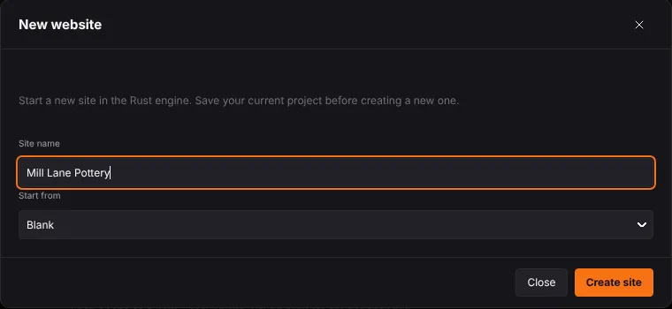

The site opens with one empty page, Home: its only layer is the page itself. In this walkthrough you leave it for later and build on a new page.

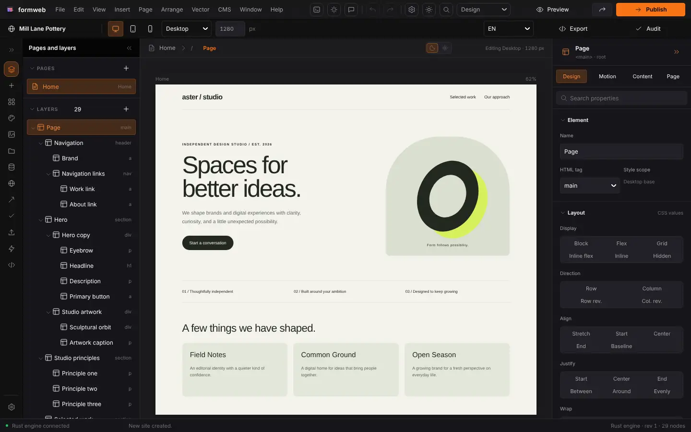

## 2. Add a page

1. In the left panel, click the **+** to the right of **PAGES**. The Add page dialog opens.
2. In **Page name** type `Classes`.
3. In **URL slug** type `/classes`. This is the page's address on your site. If you leave it empty the page gets `/new-page`.
4. Click **Add page**.

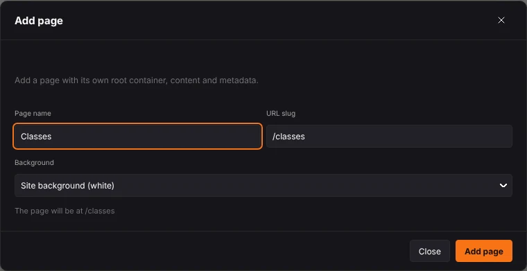

The new page opens on the canvas. It is completely white: a new page has no background of its own, so it shows the browser's default white. You give it a color in step 8.

## 3. Add a section and its content

You add everything from the **+** in the **LAYERS** heading. It opens Quick insert, a short list of elements, sections and components.

1. Click the **+** to the right of **LAYERS**.
2. Click **Section**. A dark grey section appears on the page and is selected.

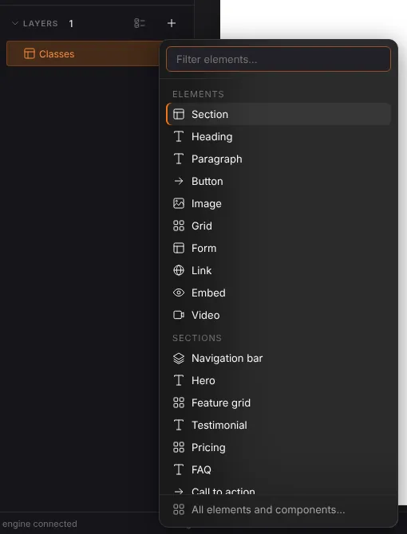

3. Click the **+** again and choose **Heading**. With the section selected, the heading goes inside it.
4. Click **+** again and choose **Paragraph**.
5. Click **+** again and choose **Image**. Your computer's file picker opens. Pick your picture. It is added under the paragraph, and its layer is named after the file.
6. Click **+** again and choose **Button**.

Each new element goes at the end of the section, after the element that was added last, so add them in the order you want them. You can always move them later (see [Pages and layers](02-pages-and-layers.md)).

The heading is hard to read: dark text on a dark section. You fix that in step 5.

Typing a few letters in the filter field at the top of Quick insert narrows the list. Up and Down move through it, and Enter inserts.

## 4. Write your own text

1. Click the heading on the canvas to select it.
2. Double-click it. The text becomes editable and is all selected.
3. Type `Pottery classes for beginners`.
4. Click an empty part of the canvas to keep the text. The status line says "Text updated."

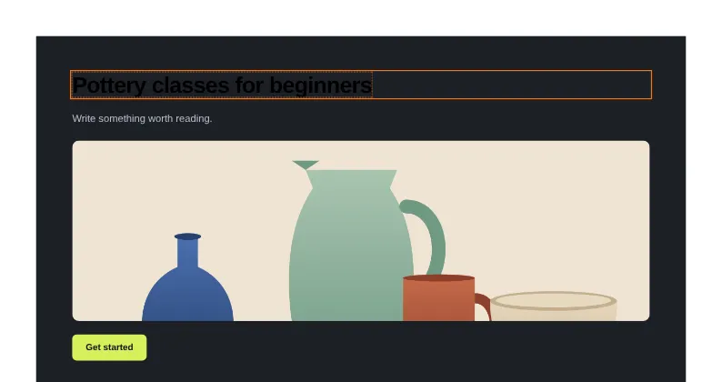

Do the same for the paragraph (`Six Tuesday evenings at the wheel. Clay, glazes and two firings are included.`) and for the button (`Book a class`).

## 5. Set colors with Search properties

The right panel has hundreds of settings. You do not need to know where each one lives: type its name in **Search properties**, the field under the tabs.

1. In the Layers list, click **Section**.
2. Click **Search properties** and type `background`. The list shows the matching settings, grouped by tab and section.
3. Press Enter, or click **Background**. The panel jumps to the Background field and puts the cursor in it.
4. Select what is in the field, type `#f4ece1` and press Enter. The section turns light.

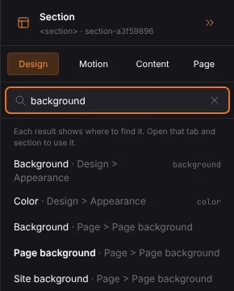

Now the paragraph text is too pale. Give it a darker color:

1. In the Layers list, click **Paragraph**.
2. In Search properties type `colour` (either spelling works).
3. Click **Color** in the results (Background is listed first, so do not just press Enter).
4. Type `#5b4636` and press Enter.

You can type a color as `#5b4636`, as a name such as `white`, or as one of the site's own colors such as `var(--paper)` (see [Page background and theme colors](05-background-and-theme-colors.md)).

## 6. Add space inside the section

1. Click **Section** in the Layers list.
2. In Search properties type `padding` and press Enter.
3. Type `64px` and press Enter.

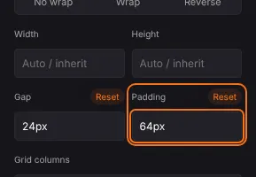

The **Reset** link next to a field removes your value, so the field goes back to what it inherits.

## 7. Check the result on the canvas

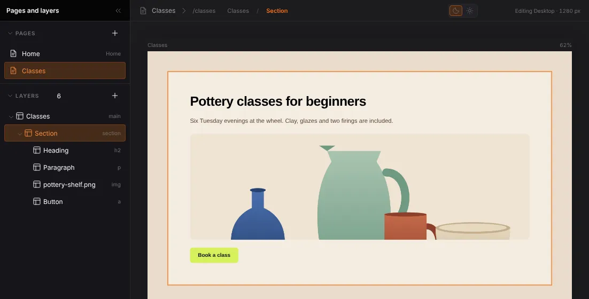

## 8. Set the page background

1. Choose **Page > Page background...**. The right panel opens the **Page** tab at its Page background field.
2. Type `#e9dccb` and press Enter.

This colors this page only. **Apply to all pages** gives every page the same background. [Page background and theme colors](05-background-and-theme-colors.md) explains the rest.

## 9. See it as a visitor would

1. Click **Preview** (the eye, in the top bar), or press Ctrl+Shift+P (Cmd+Shift+P on a Mac). The site opens over the whole window as it will be published.
2. The bar along the top has a page list, then **Full width**, **Desktop 1280**, **Tablet 820** and **Mobile 390**. Click **Mobile 390** to see the page at a phone's width, in a device frame.

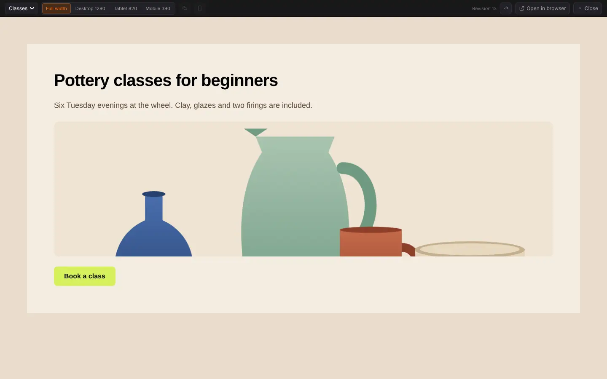

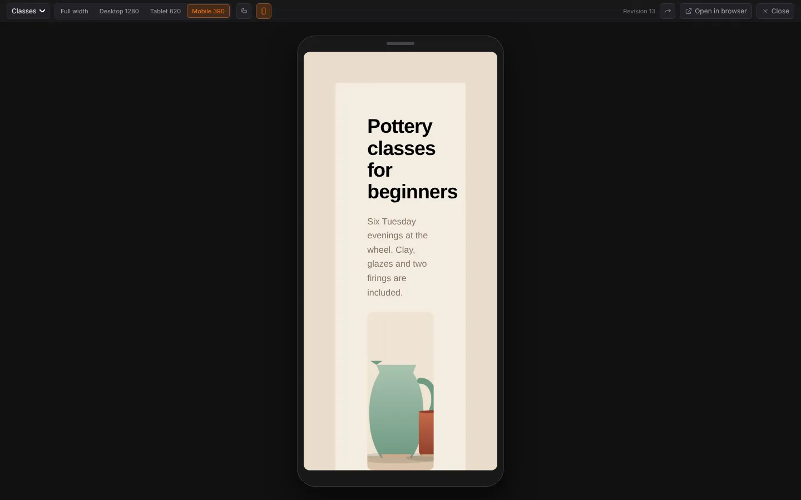

On the phone the 64 px padding leaves little room for the text. [The right panel](04-right-panel.md) shows how to give the Mobile breakpoint its own, smaller padding without changing the desktop page.

3. Click **Close**, or press Escape, to go back to the editor.

## 10. Run the audit and fix one issue

1. Click **Audit** at the right end of the second row of the top bar. The SEO & accessibility audit lists what it found on the whole site.

The first two issues are on the empty Home page; the next three are on your Classes page.

2. Click **Select** next to "Classes needs a meta description". The dialog closes, the **Page** tab opens, and the **Description** field is outlined with the cursor in it. The status line says "Selected Classes: Classes needs a meta description".

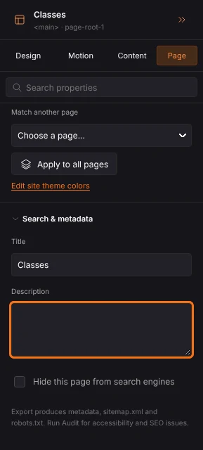

3. Type a sentence that describes the page, for example `Beginner pottery classes on Tuesday evenings at Mill Lane: six weeks at the wheel, clay and firings included.`
4. Press Tab to keep it.
5. Click **Audit** again. It now says 5 issues found.

To fix the others later: select the heading and set **HTML tag** (Design tab, Element section) to `h1`; give Home a heading and a description the same way when you build it; give the button somewhere to go with **Link URL** on the Content tab (search `href`); and see [Audit](07-audit.md) for the base URL.

## 11. Export the site

1. Click **Export** in the top bar (or choose **File > Export static site**).
2. A notice at the bottom right names the file. In a browser it reads "Downloaded mill-lane-pottery-site.zip. Your browser lists it with its downloads.", and the file is in your browser's downloads folder.

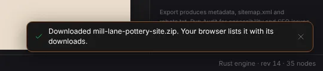

In the FormWeb desktop app the file goes straight to your Downloads folder, and the notice has a **Show in folder** button. That case is not pictured here.

The zip holds one folder per page (`index.html` for Home, `classes/index.html` for Classes), `assets/site.css`, `assets/runtime.js`, your picture, `sitemap.xml` and `robots.txt`, ready to upload to any web host. [Export and publishing](08-export-and-publish.md) says more.

## 12. Keep your work

The zip is the finished website, not your editable project. To keep working on the site later:

- **File > Save** (Ctrl+S, or Cmd+S on a Mac) keeps the project in FormWeb. Open it again from Home, under Recent or Projects.
- **File > Download .fweb project** gives you the project as a file you can copy, back up or send.

## What next

- [Pages and layers](02-pages-and-layers.md) to organise a bigger site.
- [Working on the canvas](03-canvas.md) to move and restyle things directly on the page.
