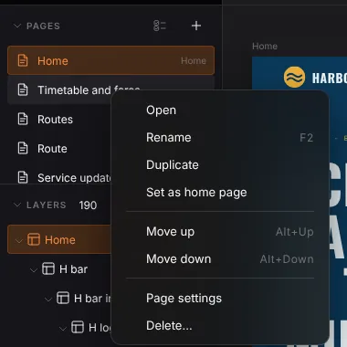
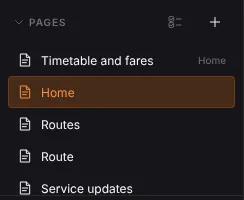
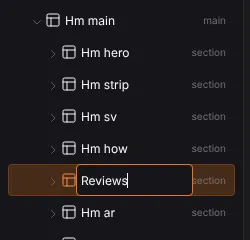
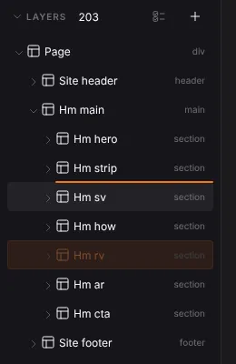

# Pages and layers

The left panel lists the pages of your site (**PAGES**) and everything on the open page (**LAYERS**). If you see something else there, click the top icon of the rail on the far left, **Pages and layers**.

A layer is one element of the page: a section, a heading, a picture, a button. Layers inside another layer are indented under it, like files in a folder.

## Follow along

The page examples use **Harbour Ferries** and the layer examples use **Coldmere Plumbing**. Open them with **Help > Demos > Harbour Ferries** and **Help > Demos > Coldmere Plumbing**. A demo opens as a new, unsaved site, so you can try everything without risk; **Edit > Undo** (Ctrl+Z, or Cmd+Z on a Mac) takes back each step.

## Open, add and rename pages

- Click a page in the PAGES list to open it on the canvas.
- Click the **+** next to PAGES to add a page. You give it a name and a URL slug, its address such as `/about`.
- To rename a page, double-click its row, or click it and press F2. The name becomes a field: type the new name and press Enter. Escape keeps the old name. This changes the name only; the page's address is changed in **Page > Page settings**.

## The page menu

Right-click a page (or select it and press Shift+F10) for its menu.

- **Duplicate** copies the page and everything on it, under a new name and address, and opens the copy.
- **Move up** and **Move down** change the order of the list. You can also drag a page: an orange line shows where it will land.
- **Delete...** asks first. A site always keeps at least one page.

## Set the home page

The home page is the one visitors see at your site's main address, `/`. In the export it becomes `index.html`. The editor marks it **Home** in the list.

Worked example in Harbour Ferries:

1. Right-click **Timetable and fares** and choose **Set as home page**.
2. The status line says: "Timetable and fares" is now the home page at /, and links to /fares now lead there.
3. Timetable and fares moves to the top of the list and gets the Home mark.

What happened to the addresses:

- Timetable and fares was at `/fares`. It now has `/`.
- The old home page keeps its content but gets an address from its name, here `/home`.
- Links on your site that pointed to `/fares` now point to `/`, so nothing breaks.

Undo puts everything back. Dragging a page to the top of the list also makes it the page the editor opens first, but only Set as home page gives it the `/` address.

## Fold and unfold

- Click the **PAGES** or **LAYERS** heading to hide or show that whole list.
- A layer with children has a small arrow before its icon. Click the arrow to fold or unfold it.
- With a layer row selected, the Right arrow key unfolds it and the Left arrow key folds it.
- Right-click a layer and choose **Collapse all** to fold everything except the page's top-level parts, or **Expand all** to open everything.

Folding is remembered on this computer for each page. It is not saved in the site.

## Rename a layer

Layer names are only for you; visitors never see them. Good names make a long page easy to find your way around.

1. In Coldmere Plumbing, click the layer **Hm rv** (the reviews section) in the Layers list.
2. Press F2, or double-click the row.
3. Type `Reviews` and press Enter.

## Drag a layer to a new place

1. Press on a layer row and drag it up or down.
2. An orange line shows where it will land: on the upper third of a row it goes before that row, on the lower third after it. Over the middle of a container (a section, a div, a header and the like) it goes inside, at the end, and the container is outlined.
3. Release to drop. The move is one undo step. Escape while dragging cancels it.

Where a drop is not allowed (inside itself, or inside a linked component) no line shows.

With a layer row selected, Alt+Up and Alt+Down move it one place without dragging.

## Select several layers

- Click a layer to select it.
- Ctrl+click (Cmd+click on a Mac) another layer to add it to the selection, or to take it out again.
- Shift+click selects every row from the last one you clicked to this one.
- Escape goes back to one layer.

The right panel then says how many elements are selected. Its fields still edit only the last one you picked, which has the solid outline on the canvas; the others have a dashed outline.

These act on the whole set, as one undo step: Copy, Cut, Paste, Duplicate, Delete, Move up and Move down, from the Edit and Arrange menus, their keys and the right-click menu. Dragging one of the selected layers drags them all.

The PAGES list works the same way: Ctrl+click and Shift+click select several pages, and Duplicate, Move up, Move down and Delete in the page menu then act on all of them.

## Next

[Working on the canvas](03-canvas.md) shows how to do the same things directly on the page.
