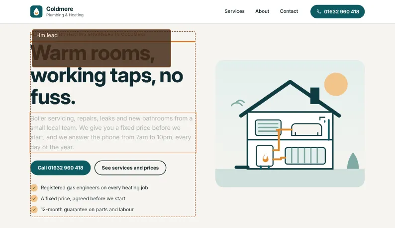
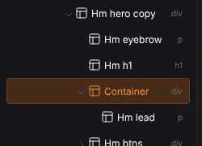

# Working on the canvas

The canvas is the page itself. You can do most layer work right on it: select, move, wrap and restyle.

## Follow along

The examples use **Coldmere Plumbing** (**Help > Demos > Coldmere Plumbing**), on its Home page.

## Select

- Click an element to select it. It gets an orange outline, its layer is highlighted in the Layers list, and the bar above the canvas shows its path, for example Home / Page / Hm main / Hm hero / Hm hero in / Hm hero copy / Hm h1.
- Click a step of that path to select a parent.
- Ctrl+click (Cmd+click on a Mac) or Shift+click adds an element to the selection or takes it out. On a Mac, Ctrl+click is a right-click and opens the canvas menu, so use Cmd or Shift there.
- Double-click text to edit it in place. Click outside it to keep the change.

## The right-click menu

Right-click an element for its menu. The element is selected first.

- **Edit text** does the same as a double click.
- **Select parent** selects the element that holds this one.
- **Add element here...** opens Quick insert. The new element goes inside this one if it is a container, otherwise at the end of its parent.
- **Text style**, **Background**, **Spacing** and **Size** open the right panel on the matching field. A link also offers **Link**, and a picture **Image source and alt text**.
- Items that cannot be used are greyed out. Paste styles stays grey until you have copied styles.

Right-click an empty part of the page, where no element is under the pointer, for **Paste**, **Add element here...**, **Page settings** and **Page background**.

While you are editing text, right-click shows your browser's own menu, so spelling suggestions still work.

## Drag to move

You can move an element by dragging it on the canvas.

1. Click the element to select it. In Coldmere, click the paragraph under the big heading (Boiler servicing, repairs...).
2. Press on it and drag. A label with its name follows the pointer and the element is dimmed in place.
3. An orange line shows exactly where it will land, between two elements. The dashed outline shows the container it will end up in.
4. Release to drop it there, or press Escape to cancel. The status line then says "Drag cancelled. Nothing moved."

Elements always land in a place in the layout, never at a loose position, so nothing ends up overlapping. A move is one undo step. Drag near the top or bottom edge of the canvas to scroll.

This is how FormWeb snaps: the orange line jumps between the places an element can go, before or after another element, or inside a container. There is no grid of x and y positions to snap to, and the dots around the page are only the stage behind it. To put elements side by side or in columns, select their container and choose **Flex** with **Direction** Row, or **Grid**, in the Layout section of the Design tab; then drag to change their order.

### On a touch screen or with a pen

- **Drag with a finger:** hold the element still for about a third of a second until it lifts (its outline grows wider; an element that was not selected is selected first), then move it without lifting your finger. The label, the orange line and the dashed outline work as with a mouse, at any zoom and scroll position.
- A quick swipe still scrolls the canvas, and a tap still selects.
- Lifting your finger outside the canvas, or putting a second finger down, cancels the drag. Nothing moves.
- **Right-click menu:** hold an element still and let go without moving.
- **Select several:** turn on the button with two ticked boxes in the LAYERS heading (or **Edit > Select several**). Each tap on the canvas then adds an element to the selection or takes it out. Tap **Done**, or press Escape, to finish.
- **A pen** drags like a mouse: press and move. Holding the pen's side button never starts a drag.

## Wrap in a container

Sometimes you want to group elements so you can style or move them together.

1. Right-click the paragraph (Hm lead).
2. Choose **Wrap in container**.

The paragraph is now inside a new, empty div called **Container**, which is selected. The status line says "Wrapped in a container. The operation is one undo step."

Drag other elements into the container, or give it a background and padding in the right panel.

## Copy and paste styles

Copy styles takes the look of one element and gives it to another.

1. Right-click the big heading (Warm rooms, working taps, no fuss.) and choose **Copy styles**. The status line says "Copied 7 styles from Hm h1 (Desktop)."
2. Scroll down and right-click the heading Heating and plumbing, start to finish.
3. Choose **Paste styles**. It now has the big heading's size and spacing. The status line says "Pasted the styles of Hm h1 (Desktop). The operation is one undo step."

Paste styles replaces all of that element's styles for the breakpoint you are editing; styles the copied element does not have are removed. Styles are copied for the breakpoint picked at the top (Desktop here). Copy styles remembers the styles in this window only.

Undo puts the second heading back.

## Next

[The right panel](04-right-panel.md) covers every setting for the selected element, and how to change it for one screen size only.
