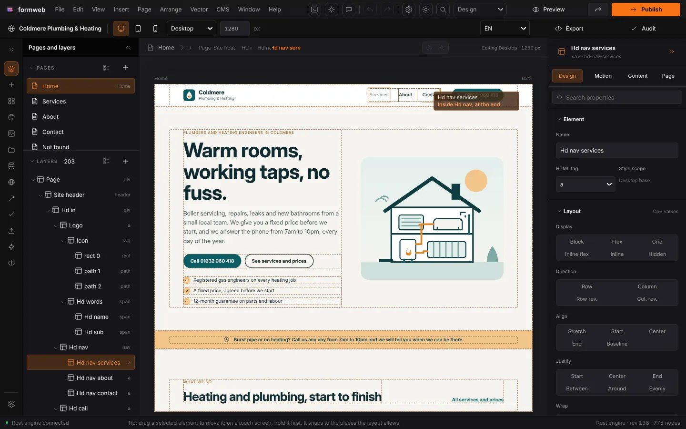
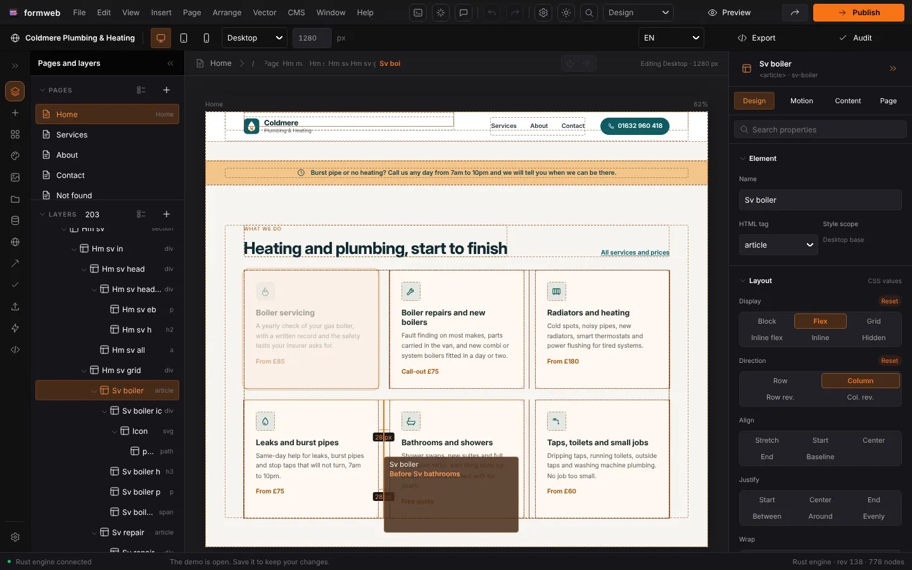

# Working on the canvas

The canvas is the page itself. You can do most layer work right on it: select, move, wrap and restyle.

## Follow along

The examples use **Coldmere Plumbing** (**Help > Demos > Coldmere Plumbing**), on its Home page.

## Select

- Click an element to select it. It gets an orange outline, its layer is highlighted in the Layers list, and the bar above the canvas shows its path, for example Home / Page / Hm main / Hm hero / Hm hero in / Hm hero copy / Hm h1.
- Click a step of that path to select a parent.
- Ctrl+click (Cmd+click on a Mac) or Shift+click adds an element to the selection or takes it out. On a Mac, Ctrl+click is a right-click and opens the canvas menu, so use Cmd or Shift there.
- Double-click text to edit it in place. Click outside it to keep the change.

## The right-click menu

Right-click an element for its menu. The element is selected first.

- **Edit text** does the same as a double click.
- **Select parent** selects the element that holds this one.
- **Add element here...** opens Quick insert. The new element goes inside this one if it is a container, otherwise at the end of its parent.
- **Text style**, **Background**, **Spacing** and **Size** open the right panel on the matching field. A link also offers **Link**, and a picture **Image source and alt text**.
- Items that cannot be used are greyed out. Paste styles stays grey until you have copied styles.

Right-click an empty part of the page, where no element is under the pointer, for **Paste**, **Add element here...**, **Page settings** and **Page background**.

While you are editing text, right-click shows your browser's own menu, so spelling suggestions still work.

## Drag to move

You can move an element by dragging it on the canvas. Over a selected element the pointer becomes the move cursor, and the first time you select an element on the canvas the status line says "Tip: drag a selected element to move it; on a touch screen, hold it first. It snaps to the places the layout allows."

1. Click the element to select it. In Coldmere, click the paragraph under the big heading (Boiler servicing, repairs...).
2. Press on it and drag. A label follows the pointer with the element's name and, under it, where it will land in words: **Before Hm h1**, **Inside Hd nav, at the end**, or **Inside** a container that is still empty. The element is dimmed in place.
3. While you drag, the layout grid shows the places it can go:
   - every container that can take the element gets a faint dashed outline;
   - inside the container under the pointer, a thin line marks each place: before its first element, between each two, and after its last;
   - the orange line is the place the element snaps to. It is always the place nearest the pointer, so anywhere inside a container that can take the element one place is offered;
   - over a container that sits next to the element you drag, such as another card in the same row, the first and last quarter of it (along the row or column) place the element before or after that container, and only its middle puts the element inside it;
   - a darker line through the neighbours shows the edge the element will line up with when that container lines its elements up on it (left, centre or right in a column; top, middle or bottom in a row), and a small measure such as **14 px** shows the gap or margin the layout will put between them.
4. Release to drop it there, or press Escape to cancel. The status line then says "Drag cancelled. Nothing moved." and everything the drag drew is gone. Any other key you press during the drag, such as a shortcut, cancels it the same way before it does its own work.

In a row the places run from left to right, so the lines stand upright, and the guides run along the top and bottom edges the elements share:

In a CSS grid the grid's own columns and rows are drawn as tinted cells, from the grid's real column and row sizes and gaps. The places follow the grid's order, row by row; where a row ends, the place is drawn both after its last cell and before the first cell of the next row.

A move is one undo step. Drag near the top or bottom edge of the canvas to scroll. With several elements selected, dragging one of them moves them all, and the label says how many ("2 elements").

### Snap and grid in a page layout

FormWeb lays a page out the way a browser does: each element sits in the flow of its container, one after another in a column, side by side in a row, or in the cells of a CSS grid. That flow is what elements snap to, and the layout grid above is a picture of it. A drop always lands in one of those places, never at a loose x and y position: no offsets are written, nothing ends up overlapping, and nothing flies around. There is no free pixel positioning and no pixel grid to snap to, because a position in pixels would only be right at one screen width, while a place in the flow stays right at every width. The guides and measures only show what the layout will do; they never change a style. The dots around the page are only the stage behind it.

To put elements side by side or in columns, select their container and choose **Flex** with **Direction** Row, or **Grid**, in the Layout section of the Design tab; then drag to change their order.

### See the structure without dragging

**View > Show layout outlines** (Ctrl+Alt+G, or Cmd+Option+G on a Mac) outlines the container of the selected element and every container around it, up to the page, and draws the cells of any CSS grid among them, so you can see the structure before you drag. It is off at first, stays as you left it in this browser, is never saved with the site or exported, and is not shown in Preview.

### On a touch screen or with a pen

- **Drag with a finger:** hold the element still for about a third of a second until it lifts (its outline grows wider; an element that was not selected is selected first), then move it without lifting your finger. The label, the layout grid and the orange line work as with a mouse, at any zoom and scroll position.
- A quick swipe still scrolls the canvas, and a tap still selects.
- Lifting your finger outside the canvas, or putting a second finger down, cancels the drag. Nothing moves.
- **Right-click menu:** hold an element still and let go without moving.
- **Select several:** turn on the button with two ticked boxes in the LAYERS heading (or **Edit > Select several**). Each tap on the canvas then adds an element to the selection or takes it out. Tap **Done**, or press Escape, to finish.
- **A pen** drags like a mouse: press and move. Holding the pen's side button never starts a drag.

## Wrap in a container

Sometimes you want to group elements so you can style or move them together.

1. Right-click the paragraph (Hm lead).
2. Choose **Wrap in container**.

The paragraph is now inside a new, empty div called **Container**, which is selected. The status line says "Wrapped in a container. The operation is one undo step."

Drag other elements into the container, or give it a background and padding in the right panel.

## Copy and paste styles

Copy styles takes the look of one element and gives it to another.

1. Right-click the big heading (Warm rooms, working taps, no fuss.) and choose **Copy styles**. The status line says "Copied 7 styles from Hm h1 (Desktop)."
2. Scroll down and right-click the heading Heating and plumbing, start to finish.
3. Choose **Paste styles**. It now has the big heading's size and spacing. The status line says "Pasted the styles of Hm h1 (Desktop). The operation is one undo step."

Paste styles replaces all of that element's styles for the breakpoint you are editing; styles the copied element does not have are removed. Styles are copied for the breakpoint picked at the top (Desktop here). Copy styles remembers the styles in this window only.

Undo puts the second heading back.

## Next

[The right panel](04-right-panel.md) covers every setting for the selected element, and how to change it for one screen size only.
