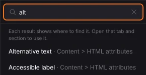
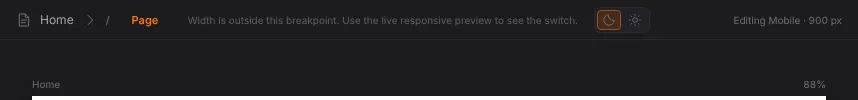

# The right panel

The right panel shows the settings of whatever is selected. If it is hidden, press Ctrl+] (Cmd+] on a Mac) or choose **Window > Right panel**.

## Follow along

The examples use **Coldmere Plumbing** (**Help > Demos > Coldmere Plumbing**), on its Home page.

## The four tabs

At the top the panel names the selected element and its HTML tag, for example **Hm hero img** and ``. Under that are four tabs:

- **Design**: how the element looks and sits on the page. Its sections are Element (name, HTML tag and Style scope), Layout (display, direction, alignment, width, height, gap, padding, margin), Appearance (background, color, radius, border, opacity, shadow), Typography (font size, weight, line height and more), Position, Transform 3D and Effects.
- **Motion**: movement and behavior: Presets, Reveal, Scene, Loop, Counter, Text, Drag, Pointer, Disclosure (accordion, tabs or filter chips), Actions (run an action on a trigger) and Script.
- **Content**: the text, and the HTML attributes such as **Link URL**, **Image / media URL** and **Alternative text** (the description of a picture for people who cannot see it), with **Decorative image (no description)** under it for a picture that carries no meaning.
- **Page**: settings for the open page, whatever is selected: Page settings (name and address), Page background, Search & metadata (the title and description search engines show), Custom code, Password, Whole site (settings such as the base URL) and Actions.

With a Page script selected (a script imported without HTML of its own), the panel opens the Content tab on its code, and Design and Motion only say that these settings do not apply to it, because a script has no box on the page. See [A page script](09-importing.md#a-page-script).

Many fields show a grey placeholder such as Auto / inherit. That means the element has no value of its own and uses what it inherits. A field you have set gets a **Reset** link that removes your value again.

## Sliders, color pickers and layout choosers

You do not have to type CSS to style an element. Seventeen fields in the Design tab have a control beside their text box: a slider, a color swatch or a layout button.

The text box always stays. What it holds is the value that is saved and exported, and a control only writes into it. So you can always type a value instead, for example one of the site's colors such as `var(--accent)`, and press Enter, as before.

A few things are true of every control:

- **One change is one undo step.** One drag, one click on a color or a layout, or one key held down is one step. Ctrl+Z (Cmd+Z on a Mac) takes it back, also while the focus is still on the slider, the swatch, a stop, a button, the picker's square or bars, or a layout in the chooser. In a text box, Ctrl+Z undoes your typing in that box. From a unit list, press Tab (or click elsewhere) first.
- **Delete is safe.** While the focus is on a swatch, a slider, a unit list, a layout button, the `</>` switch, or anything inside the color picker or the layout chooser, Delete and Backspace never remove the selected element.
- **Nothing happens on the page until you let go or click.** While you drag, the text box shows the new value; the value is kept when you release the mouse button. Press Escape during the drag to keep the old value. Resting the pointer on a choice changes nothing.
- **A value the control cannot show is left alone.** If the field holds something the control cannot draw, such as two values (`8px 16px`), `calc(...)` or a word such as `auto`, the control hides and the text box holds the value exactly as typed. The control comes back as soon as the field holds a value it can show. Nothing in the panel moves when this happens.

### Sliders and units

**Opacity**, **Width**, **Height**, **Max width**, **Gap**, **Padding**, **Margin**, **Radius**, **Font size**, **Line height**, **Letter spacing**, **Top** and **Left** have a slider under the text box, and most have a unit list after it (px, %, rem, em and others).

1. In Coldmere, click the house picture on the home page. The panel shows **Hm hero img**.
2. In the Appearance section, find **Radius**. It reads `28px`.
3. Drag the slider's thumb to the right. The text box counts up as you drag; the picture's corners change when you let go.
4. Press Ctrl+Z (Cmd+Z on a Mac). The radius is `28px` again.

More about sliders:

- Click anywhere on the track to jump there.
- A hollow thumb means the field is not set. On Tablet or Mobile, a grey thumb shows the value the field inherits from a wider breakpoint.
- Each slider's range is fixed: Opacity goes from 0 to 1, Width from 0 to 1600 px, Font size from 8 to 96 px, and so on. For a bigger value, type it in the box. The thumb then sits at the end, and your value is kept as typed.
- The unit list changes the unit and keeps the number: `12px` becomes `12rem`, which is a much bigger size. It does not convert. Line height also offers ×, a plain number with no unit.
- With the slider focused (click it, or press Tab to reach it), the arrow keys move it one step, Shift with an arrow ten steps, and Home and End go to the ends.
- In the text box itself, Up and Down step a single number by one slider step and keep its unit: `12px` becomes `13px`, `1rem` becomes `1.25rem`, Opacity `0.5` becomes `0.51`. With Shift the step is ten times larger. This works on these 13 fields only, and not while a field is switched to CSS text.

### The color picker

**Color** and **Background** have a swatch before the text box. It shows the color the field holds; a site color shows its own color, a gradient shows as a small gradient, and an empty field shows a diagonal line.

1. Click the heading Warm rooms, working taps, no fuss.
2. In the Appearance section, click the swatch before **Color** (its tooltip says Choose Color). The color picker opens beside the panel.

3. Click one of the **SITE COLORS** swatches. Its tooltip names it, for example accent (#e0892b). The heading takes that color, and the Color field reads `var(--accent)`.

What the picker holds, from top to bottom:

- **The square** sets how strong and how light the color is: drag in it, or click.
- **The rainbow bar** sets the hue, and **the bar under it** sets the opacity, from see-through on the left to solid on the right. When the field has no color yet, or holds black, white or a grey, a click on the rainbow bar gives that hue at once, fairly strong and light, which you can then adjust in the square.
- **The text box** next to the small chip takes a color code: type `#5b4636`, `5b4636` or `rgb(91, 70, 54)` and press Enter.
- **The eyedropper button** at the end of that row (tooltip Pick a color from the screen) lets you click anywhere on your screen to take its color. It is there only when your browser or system offers it.
- **SITE COLORS** are the site's own colors (see [Theme colors](05-background-and-theme-colors.md#theme-colors-change-a-color-everywhere-at-once)). **BRAND** and **TEAM LIBRARY** show the colors of the brand kit (**Window > Brand kit**) when it has some. A long list scrolls in its own box, so No color stays in view.
- **No color** empties the field, so the element uses what it inherits again, and closes the picker.

A color you mix with the square and bars is written as a color code, such as `#c8f25a`, or `#c8f25a80` when it is partly see-through. A site, brand or team color is written as its name, such as `var(--accent)`, so the element follows that color when the site's color changes.

The picker closes when you press Escape (the focus goes back to the swatch), click outside it, or select another element. Undo and Redo keep it open, and it follows the value. If you open it right after typing a value, it starts from what you typed, even while that is still being saved. When the brand restriction is on (in **Window > Brand kit**), the picker offers only the brand and team colors and No color, with a sentence that says so.

### Gradients

The picker of **Background** has two tabs at the top: **Solid** and **Gradient**.

1. In the Layers list, click **Hm hero**, the first section of the home page.
2. Click the swatch before **Background**, then click the **Gradient** tab. It shows a starting gradient; nothing has changed on the page yet.
3. Click **Use gradient**. The section gets the gradient, and the Background field holds it as CSS, such as `linear-gradient(135deg, #5b3cc4 0%, #a594df 100%)`.
4. Click the middle of the bar to add a color stop there, then use the square and bars under it to give that stop its color.

What you can do in the tab:

- **Linear** or **Radial**: a gradient along a line, or out from a point.
- **The bar** shows the gradient with a handle for each stop. Click the bar to add a stop, drag a handle to move it, and click a handle to select it. **Position** shows where the selected stop sits, in percent.
- **Add stop** (the + button) adds a stop and **Remove stop** (the bin button) removes the selected one. A gradient always keeps at least two stops.
- **The square and bars** under the bar set the selected stop's color, as on the Solid tab.
- **Angle** (in degrees) and the eight arrows set the direction of a linear gradient. A radial gradient offers **Circle** or **Ellipse** there instead.
- **Reverse** swaps the colors end for end.

Each of these is one undo step. The tab writes one plain CSS gradient, and the export keeps it exactly as written. If you type a gradient yourself, the picker opens on the Gradient tab when it can show all of it, and your text stays as typed until you change something in the tab. From then on the tab writes the gradient in its own plain form, which looks the same: every stop gets a position, the stops are in order, and positions are rounded to two decimals (`33.333%` becomes `33.33%`). A gradient it cannot show, such as a conic or repeating gradient or several layers, is left exactly as typed, and the picker stays on Solid.

A handle with the focus (click it, or reach it with Tab) also takes the keyboard: the arrow keys move its stop by 1 % (Shift by 10 %), Home and End move it to the ends, and Delete or Backspace removes it.

### Grid columns and rows

**Grid columns** and **Grid rows** (in the Layout section) have a button before the text box with a small drawing of the current layout.

1. In the Layers list, click **Hm sv grid**, the box that holds the service cards under Heating and plumbing, start to finish.
2. Click the button before **Grid columns**. The chooser opens.

3. Click **2 columns**. The cards rearrange into two columns, and the field reads `repeat(2, 1fr)`. Ctrl+Z puts the old layout back.

Every layout shows the CSS it writes under its name. **Any number of columns** takes a number from 1 to 12: type it in the box and press Enter, or click the layout beside the box. Under **AS MANY AS FIT**, the page puts as many columns side by side as fit at the width it is viewed at, each at least the size named. Grid rows offers equal rows and **Header, content, footer** and **Header and content**.

The chooser takes the keyboard too: the arrow keys move between the layouts, Enter or Space chooses one, and Escape closes it.

**Make this element a grid.** Columns and rows only work on an element whose **Display** is **Grid**. When you open the chooser on any other element, it says so at the top, for example "Grid columns only takes effect when this element's Display is Grid.", and offers **Make this element a grid**. Click a layout first (it is marked, and the CSS that will be written appears under the button), then click **Make this element a grid**. Display and the layout are set together, as one undo step.

### Type the CSS instead

Each of these fields has a small `</>` switch at the right of its label (its tooltip begins Type Radius by hand, with that field's name). Click it, and that one field becomes a plain text box with no control; click it again to bring the control back.

To choose for every field at once, open **Edit > Settings...** (Ctrl+, or Cmd+, on a Mac), click **Interface**, and set **Show in Design fields** under Design fields to **Controls** or **CSS text**. Fields you switched yourself keep their own choice; **Use for all fields** makes them follow the setting again. **View > Show controls in Design fields** switches the same setting from the menu.

These choices are kept in this browser only. They are never saved with the site, and they never change a value.

## Search properties

You do not have to know which tab or section holds a setting. Type its name in **Search properties**, the field under the tabs (or press Ctrl+Alt+F, Cmd+Option+F on a Mac).

1. In Coldmere, click the house picture on the home page.
2. Click **Search properties** and type `rounded`.
3. The list shows Design > Appearance > **Radius**, with its CSS name `border-radius` on the right.

4. Press Enter, or click Radius. The panel switches to that tab, opens the section, scrolls to the field, puts the cursor in it and outlines it for a moment.

5. Change the value and press Enter. Press Escape in the search field to clear it; the panel comes back exactly as you left it.

A search matches the setting's label, its section, its CSS name and some everyday words. These queries were tried in this version:

| You type | You get |
| --- | --- |
| `background` | Background and Color (Design > Appearance), Page background (Page) |
| `colour` or `color` | Background and Color |
| `rounded` or `corner` | Radius |
| `elevation` | Shadow |
| `spacing` | Letter spacing, Gap, Padding, Margin |
| `font size` | Font size, Line height |
| `alt` | Alternative text, Accessible label (Content > HTML attributes) |
| `href` | Link URL, Image / media URL, URL, URL slug, Base URL |
| `seo` | Title, Description, Hide this page from search engines (Page > Search & metadata) |

When you type several words, every word must match. Up and Down move through the results.

## Breakpoints: different styles for different screens

A breakpoint is a range of screen widths with its own styles. Every site has **Desktop**, **Tablet** and **Mobile**.

- **Desktop** holds the base styles. They apply to every screen size unless a narrower breakpoint changes them.
- **Tablet** and **Mobile** hold only the changes for those widths. A change on Tablet also applies on Mobile, unless Mobile changes it again.

### Pick the breakpoint you want to edit

You choose the breakpoint yourself, in the second row of the top bar: click the **Desktop**, **Tablet** or **Mobile** button, or pick one from the breakpoint list next to them. The canvas then shows the page at that breakpoint's width, the bar above the canvas says for example "Editing Mobile · 390 px", and every style you set from now on is stored for that breakpoint only.

**The canvas never switches breakpoint by itself.** Resizing the window, or typing another width in the width box next to the list, only changes the size of the frame. The canvas keeps showing and editing the breakpoint you picked. To see the page switch layouts as the width changes, use the Live responsive preview (see [Preview](06-preview.md)).

### Worked example: a smaller heading on phones

The big heading on Coldmere's home page is large on a phone. Make it smaller there, and only there.

1. Click the heading Warm rooms, working taps, no fuss.
2. Pick **Mobile** in the breakpoint list (or click the phone button). The canvas narrows to 390 px.
3. Look at **Style scope** in the Element section of the Design tab: it says mobile override.
4. In Search properties type `font size` and press Enter.
5. Type `34px` and press Enter. The heading shrinks on the canvas.

6. Click the **Desktop** button. The heading is as large as before: the 34 px applies to phones only.

Use the same steps for the padding of the first-site walkthrough: on Mobile, give the section a padding of `24px`.

### When the width does not match the breakpoint

If you type a width that falls outside the picked breakpoint, for example 900 while Mobile is picked, the bar above the canvas says: "Width is outside this breakpoint. Use the live responsive preview to see the switch." The canvas still draws the Mobile styles, at 900 px wide. The note has room in the bar, on up to three lines if it needs them (on a page with a scroll scene and a narrow canvas, it gives its place to the scene controls); when the selection path is long, the steps in its middle fold into one "..." step instead. Click "..." for a menu of the hidden steps and pick one to select that element. The selected element's step is always shown, and its name ends in "..." when it is too long for the room left.

The Desktop, Tablet and Mobile buttons remember the width you last typed for each one. Type the width again (for example 1280 for Desktop) to go back to the usual size.

## Next

[Page background and theme colors](05-background-and-theme-colors.md).
