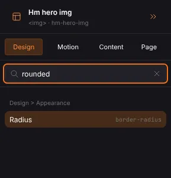
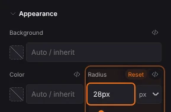
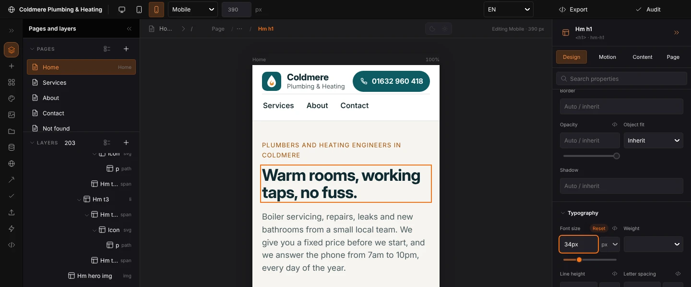

# The right panel

The right panel shows the settings of whatever is selected. If it is hidden, press Ctrl+] (Cmd+] on a Mac) or choose **Window > Right panel**.

## Follow along

The examples use **Coldmere Plumbing** (**Help > Demos > Coldmere Plumbing**), on its Home page.

## The four tabs

At the top the panel names the selected element and its HTML tag, for example **Hm hero img** and ``. Under that are four tabs:

- **Design**: how the element looks and sits on the page. Its sections are Element (name, HTML tag and Style scope), Layout (display, direction, alignment, width, height, gap, padding, margin), Appearance (background, color, radius, border, opacity, shadow), Typography (font size, weight, line height and more), Position, Transform 3D and Effects.
- **Motion**: movement and behavior: Presets, Reveal, Scene, Loop, Counter, Text, Drag, Pointer, Disclosure (accordion, tabs or filter chips), Actions (run an action on a trigger) and Script.
- **Content**: the text, and the HTML attributes such as **Link URL**, **Image / media URL** and **Alternative text** (the description of a picture for people who cannot see it), with **Decorative image (no description)** under it for a picture that carries no meaning.
- **Page**: settings for the open page, whatever is selected: Page settings (name and address), Page background, Search & metadata (the title and description search engines show), Custom code, Password, Whole site (settings such as the base URL) and Actions.

Many fields show a grey placeholder such as Auto / inherit. That means the element has no value of its own and uses what it inherits. A field you have set gets a **Reset** link that removes your value again.

## Search properties

You do not have to know which tab or section holds a setting. Type its name in **Search properties**, the field under the tabs (or press Ctrl+Alt+F, Cmd+Option+F on a Mac).

1. In Coldmere, click the house picture on the home page.
2. Click **Search properties** and type `rounded`.
3. The list shows Design > Appearance > **Radius**, with its CSS name `border-radius` on the right.

4. Press Enter, or click Radius. The panel switches to that tab, opens the section, scrolls to the field, puts the cursor in it and outlines it for a moment.

5. Change the value and press Enter. Press Escape in the search field to clear it; the panel comes back exactly as you left it.

A search matches the setting's label, its section, its CSS name and some everyday words. These queries were tried in this version:

| You type | You get |
| --- | --- |
| `background` | Background and Color (Design > Appearance), Page background (Page) |
| `colour` or `color` | Background and Color |
| `rounded` or `corner` | Radius |
| `elevation` | Shadow |
| `spacing` | Letter spacing, Gap, Padding, Margin |
| `font size` | Font size, Line height |
| `alt` | Alternative text, Accessible label (Content > HTML attributes) |
| `href` | Link URL, Image / media URL, URL, URL slug, Base URL |
| `seo` | Title, Description, Hide this page from search engines (Page > Search & metadata) |

When you type several words, every word must match. Up and Down move through the results.

## Breakpoints: different styles for different screens

A breakpoint is a range of screen widths with its own styles. Every site has **Desktop**, **Tablet** and **Mobile**.

- **Desktop** holds the base styles. They apply to every screen size unless a narrower breakpoint changes them.
- **Tablet** and **Mobile** hold only the changes for those widths. A change on Tablet also applies on Mobile, unless Mobile changes it again.

### Pick the breakpoint you want to edit

You choose the breakpoint yourself, in the second row of the top bar: click the **Desktop**, **Tablet** or **Mobile** button, or pick one from the breakpoint list next to them. The canvas then shows the page at that breakpoint's width, the bar above the canvas says for example "Editing Mobile · 390 px", and every style you set from now on is stored for that breakpoint only.

**The canvas never switches breakpoint by itself.** Resizing the window, or typing another width in the width box next to the list, only changes the size of the frame. The canvas keeps showing and editing the breakpoint you picked. To see the page switch layouts as the width changes, use the Live responsive preview (see [Preview](06-preview.md)).

### Worked example: a smaller heading on phones

The big heading on Coldmere's home page is large on a phone. Make it smaller there, and only there.

1. Click the heading Warm rooms, working taps, no fuss.
2. Pick **Mobile** in the breakpoint list (or click the phone button). The canvas narrows to 390 px.
3. Look at **Style scope** in the Element section of the Design tab: it says mobile override.
4. In Search properties type `font size` and press Enter.
5. Type `34px` and press Enter. The heading shrinks on the canvas.

6. Click the **Desktop** button. The heading is as large as before: the 34 px applies to phones only.

Use the same steps for the padding of the first-site walkthrough: on Mobile, give the section a padding of `24px`.

### When the width does not match the breakpoint

If you type a width that falls outside the picked breakpoint, for example 900 while Mobile is picked, the bar above the canvas says: "Width is outside this breakpoint. Use the live responsive preview to see the switch." The canvas still draws the Mobile styles, at 900 px wide. The note always has room in the bar, on two lines if it needs them; when the selection path is long, the steps in its middle fold into one "..." step instead. Click "..." for a menu of the hidden steps and pick one to select that element. The selected element's step is always shown.

The Desktop, Tablet and Mobile buttons remember the width you last typed for each one. Type the width again (for example 1280 for Desktop) to go back to the usual size.

## Next

[Page background and theme colors](05-background-and-theme-colors.md).
