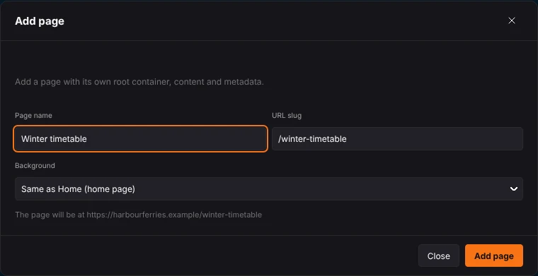

# Page background and theme colors

## Follow along

The examples use **Coldmere Plumbing** (**Help > Demos > Coldmere Plumbing**) and **Harbour Ferries** (**Help > Demos > Harbour Ferries**), on their Home pages.

## Why a new page is white

A page's background is the background of its top layer, the page itself (the first row in the Layers list). A new page has no background of its own, so it shows what a browser shows for a page with no colors: a white background and black text. That is true on the canvas and in the exported site alike.

So when you add a page to a site with a colored design, the new page starts white unless you choose otherwise. You decide where a page's background comes from, in three places:

- when you add the page, with **Background** in the Add page dialog;
- afterwards, with **Match another page** in the Page background section;
- for every page at once, with **Apply to all pages**, or by changing a theme color the pages share (see below).

## Choose the background of a new page

The Add page dialog (the **+** next to PAGES, or **Add page...** in a page's right-click menu) has a **Background** list:

- **Site background (white)**, chosen at first: the page has no background of its own, so it is white with black text.
- **Same as Home (home page)**: the new page starts with the home page's background and text color.
- **Same as** the page open now: the page you were on when you clicked **+**, for example "Same as Contact, the page open now". This item is there when the open page is not the home page.

Worked example in Harbour Ferries: open **Timetable and fares**, click the **+** next to PAGES, type `Winter timetable`, choose **Same as Home (home page)** and click **Add page**. The new page opens with Home's light grey-blue background, `var(--bg)`. Undo takes the new page away in one step.

The new page gets a copy of the values, not a link: if you later type a new background on Home, the other page keeps its own. To change several pages together, give them a theme color, as described below.

## Where the setting is

Choose **Page > Page background...**, right-click an empty part of the page and choose **Page background**, or right-click the page in the PAGES list and choose **Page background...**. The right panel opens the **Page** tab at its **Page background** section.

- **Background** takes a color such as `#f3efe6`, a color name, a gradient, or one of the site's colors such as `var(--paper)`. Press Enter to keep it. If the browser cannot read what you typed as a background (for example two values run together, like `var(--bg)#f3efe6`), the field goes back to what it was and the status line says why.
- The note under the field says what the page uses now, and which other pages use the same value (for example "Home +7 uses var(--bg)").
- **Clear** (also **Page > Clear page background**) removes this page's own background. The page is white again.
- **Match another page** gives this page the background and text color of the page you pick in the list. The home page comes first, marked "(home page)". The list goes back to "Choose a page..." and the status line confirms it, for example "The background and text color of "Home" are now used on "Hello"." It is one undo step. **Page > Use the home page background** does the same with the home page in one click.
- **Apply to all pages** (also **Page > Use this page background on all pages**) gives every page this page's background, in one undo step. The status line confirms it, for example "Background #f3efe6 applied to all 8 pages."
- The field always sets the page's base (Desktop) style, whatever breakpoint the canvas shows.

## Theme colors: change a color everywhere at once

Well-built sites do not repeat the same color code on every element. They name their colors once, as tokens, and use the name everywhere: `var(--paper)` means "the paper color", whatever it is set to. Change the token, and every element and page that uses it changes with it.

Coldmere's pages use `var(--paper)` as their background, which is `#f6f4ef`.

1. In the Page background section, click **Edit site theme colors**. The Design system tokens dialog opens. (It is also **Window > Design system...**.)
2. The list shows every token of the site with its value: `--accent`, `--btn-bg`, `--deep`, `--paper` and so on, and also fonts and sizes.

3. Find the token, type a new value in its field, and press Enter.

In Harbour Ferries the pages use `var(--bg)`, which is `#f3f6f7`. Setting `--bg` to `#efe8da` turns every page that uses it warm beige at once, on the canvas and in the export. Undo puts it back.

### Light and dark themes

Below the token list, the **Themes** block lets a site have a second set of values for the other theme (light or dark): fill a token there to give it another value in that theme, and leave it empty to keep the default. The moon and sun buttons above the canvas show the page in each theme. A site with no themes says so in the block: Default theme reads None, every visitor sees the one set of colors, and the moon and sun buttons are greyed out, because the published page has no other theme to show. Pick Dark or Light as the default theme to start a second set of values; picking None again removes the themes. Visitors can switch themes, and their choice is remembered on their device.

## Next

[Preview](06-preview.md).
