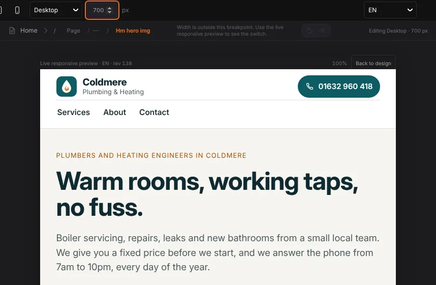

# Preview

The canvas is built for editing: it draws your page so you can click and change it, but it does not run the site's scripts, menus, forms or animations. To see the real thing, FormWeb builds the site exactly as it will be exported and shows that. There are two ways.

## Follow along

The examples use **Harbour Ferries** (**Help > Demos > Harbour Ferries**) and **Coldmere Plumbing** (**Help > Demos > Coldmere Plumbing**).

## Preview as published

This opens the finished site over the whole window, with none of the editor around it.

1. Click **Preview** (the eye) in the top bar, or choose **View > Preview as published**, or press Ctrl+Shift+P (Cmd+Shift+P on a Mac).
2. Use the bar along the top:
   - the **page list** on the left picks the page to show. If you follow a link inside the preview it reads "Page opened from a link" until you pick a page again;
   - **Full width**, then one button per breakpoint with its width: **Desktop 1280**, **Tablet 820**, **Mobile 390**;
   - for Tablet and Mobile, **Rotate the device** (turns it sideways) and **Device frame** (the drawn frame, on at first);
   - a language list, when the site has more than one language;
   - **Revision** with its number, **Refresh** (builds the current version again), and **Open in browser**, which opens the same preview in a browser tab (in the desktop app, your system browser). That link works on this computer for one hour;
   - **Close**.
3. Click links, open menus, try the forms: everything works as it will for a visitor.
4. Press Escape or click **Close** to go back. If you have clicked inside the previewed page, click the bar first, because your keys go to the page.

Worked example in Harbour Ferries: click **Tablet 820**, then **Rotate the device**. You see the home page on a tablet held sideways.

While the preview is open you cannot click the editor underneath. If the site changes meanwhile (for example an agent edits it), the preview loads the new version by itself.

## Live responsive preview

This shows the built site inside the canvas area, at the width in the width box, so you can watch the layout change as the width changes.

1. Choose **View > Live responsive preview**. The label above the canvas changes to, for example, "Live responsive preview · EN · rev 147".
2. Type a width in the width box in the top bar (for example `700`) and press Enter. The site switches layouts by itself, the way a browser does, because its own CSS decides at each width.

3. Choose **View > Live responsive preview** again to go back to editing.

While it is on, clicks inside the page do not select anything: it is a preview, not the editor. **View > Refresh live responsive preview** builds it again.

## Which one to use

| | Live responsive preview | Preview as published |
| --- | --- | --- |
| Where | Inside the canvas area, with the panels still there | Over the whole window |
| Width | Any width you type | Full width or one button per breakpoint, with a device frame |
| Breakpoints | Switch by themselves as the width crosses them | Switch by themselves; each button shows one |
| Can you edit meanwhile | No, turn it off first | No, close it first |
| Best for | Finding the width where a layout breaks | Checking the site page by page as a visitor |

The editing canvas never switches breakpoint by itself (see [The right panel](04-right-panel.md)). Both previews do, because they show the real site.

## Next

[Audit](07-audit.md).
