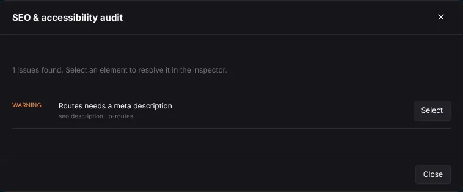

# Audit

The audit reads your whole site and lists what could stop people or search engines from using it well. It is a helper, not a certificate: read your pages yourself too.

## Follow along

The example uses **Harbour Ferries** (**Help > Demos > Harbour Ferries**). Out of the box the demo passes the audit, so first make a small mistake on purpose:

1. Click **Routes** in the PAGES list.
2. In Search properties type `description` and press Enter. The page's **Description** field (Page tab, Search & metadata) gets the cursor.
3. Select its text, delete it, and press Tab.
4. Click **Home** in the PAGES list to go back to the home page.

## Run the audit

1. Click **Audit** at the right end of the second row of the top bar (or choose **Page > Run SEO and accessibility audit**).
2. The SEO & accessibility audit dialog lists each issue with its kind (WARNING), a sentence, a short code and the page or element it is about.

## Go straight to the problem with Select

1. Click **Select** next to the issue.
2. The dialog closes and FormWeb takes you there: it opens the Routes page, opens the **Page** tab, scrolls the empty **Description** field to the middle of the panel, puts the cursor in it and outlines it. The status line says "Selected Routes: Routes needs a meta description", and a notice at the bottom right says the same, so you do not have to remember it.

The notice stays for about 30 seconds, and as long as your pointer is on it. **Show again** takes you back to the same place (the page, the element or the field) if you have clicked elsewhere meanwhile; you do not need to open the audit again. The cross closes the notice.

3. Type a description and press Tab. Run the audit again: the issue is gone.

For an issue about an element, Select opens its page, selects the element, scrolls the canvas to it and makes its outline pulse for about two seconds.

## What it checks

These are the checks the audit runs in this version, with the sentence you will see:

**Search engines**

- A page without a title, or without a description ("... needs a meta description").
- A site whose base URL is not set yet ("Set the real public base URL before deployment"). Set it in the Page tab, **Whole site** section, once you know your site's address. A site with a 404 page also gets a note about its links.
- Two pages whose addresses differ only in capital letters, such as `/two` and `/TWO`, which a site saved by an older FormWeb can have. On a Mac or a Windows computer they would be one folder. Select opens the second page's settings at its URL slug: give it another address.

**People using a keyboard, a screen reader or a small screen**

- Pages with no h1 heading, or more than one ("... has 0 h1 headings; prefer one"), and headings that skip a level.
- Text whose color is too close to its background ("Text contrast 4.47:1 is below the 4.5:1 minimum").
- Pictures with no alt text at all ("Image needs alt text (empty alt is valid for decoration)").
- Buttons and links with no text or name, and links that go nowhere ("Link needs a destination").
- Form fields without a label, repeated HTML ids, tables without header cells or a caption, and drawings (SVG) without a label.
- Hover effects, as a reminder to make them work with a keyboard and touch too.

**Export**

- Pictures loaded from another website, which are not copied into your zip.
- A form that sends its answers to this computer, which will not work once the site is on another host (see [Export and publishing](08-export-and-publish.md)).

A picture you insert from a file starts with no alt text, so the audit lists it until you describe it in the Content tab, **Alternative text** (search `alt`). Clearing that field takes the description away again. A picture that is only decoration, such as a pattern or a divider, needs no description: tick **Decorative image (no description)** under the field. That writes an empty alt text on purpose, screen readers skip the picture, and the audit no longer flags it.

## Next

[Export and publishing](08-export-and-publish.md).
