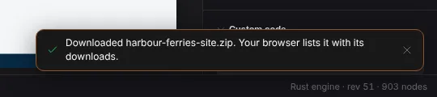
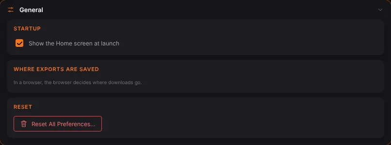

# Export and publishing

When your site is ready, you take it out of FormWeb as a finished website. There are three ways: export a zip, hand it to FormPublisher, or publish a version on this computer.

## Follow along

The example uses **Harbour Ferries** (**Help > Demos > Harbour Ferries**). Run the [audit](07-audit.md) first and fix what it finds.

## Export a zip

1. Click **Export** in the second row of the top bar, or choose **File > Export static site**.
2. While the zip is being made, the Export button shows a busy pointer and you cannot start a second export.
3. When it is done the status line says "Static site exported for English." and a notice at the bottom right names the file.

### Where the file goes

- **In a browser**, the zip is downloaded like any other file: the notice says "Downloaded harbour-ferries-site.zip. Your browser lists it with its downloads." Open your browser's downloads list to find it, usually in your Downloads folder.
- **In the FormWeb desktop app**, the zip is saved straight to your Downloads folder at first, without asking; you can choose another place (see below). The notice says "Exported harbour-ferries-site.zip to" and the folder, and has a **Show in folder** button that shows the file in Finder or File Explorer (on Linux it opens the folder). If a file of that name is already there, the new one is named, for example, `harbour-ferries-site (1).zip`, and the notice gives the real name. The desktop app is not pictured in this guide.

The notice stays for about 12 seconds, longer while your pointer is on it. If the export fails, it says so in red.

### Choose where exports are saved

Open **Edit > Settings...** (Ctrl+, or Cmd+, on a Mac) and look under **General**, **Where exports are saved**. In a browser this row only says that the browser decides where downloads go: your browser's own settings choose the folder.

In the desktop app the row has three choices:

- **The Downloads folder**, chosen at first.
- **A folder you choose**: click **Choose folder...**, pick a folder in the system's folder dialog, and its path shows beside the button. Every export goes there, and the notice names that folder.
- **Ask each time**: the system's save dialog opens before anything is saved, with the file's name filled in. Choose a place, or press Cancel; then nothing is saved and the status line says "Nothing was saved."

Export static site, Download .fweb project, QR codes and picture exports all follow this choice. If the chosen folder has been deleted, renamed, unplugged or cannot be written when a file is saved, the file goes to your Downloads folder instead, and a red notice says that the chosen folder is missing or cannot be written and names where the file went. The choice is kept by the app, so it is still there after a restart; **Reset All Preferences** puts it back to the Downloads folder.

### What is in the zip

A folder you can upload as it is to any web host that serves plain files:

- `index.html` for the home page and one folder per page, such as `routes/index.html`; Harbour Ferries also gets one folder per route from its CMS collection, such as `routes/west-sands/index.html`;
- `assets/site.css`, `assets/runtime.js`, your pictures and fonts, and for Harbour Ferries one stylesheet per page in `assets/pages/`;
- `sitemap.xml` and `robots.txt` for search engines, and a `404.html` when the site has a page at `/404`;
- `site.formweb.json`, `routes.json`, `asset-access.json` and a `README.txt` that describe the export, plus files the site's features need (Harbour Ferries has `redirects.json`, `search-index.json` and `site.webmanifest`).

Before you upload, set your site's real address in the Page tab, **Whole site** section (**Base URL**), so links, the sitemap and the 404 page point to the right place.

The zip is the finished site, not your editable project. Keep the project too: **File > Save**, or **File > Download .fweb project** for a file.

## Send to FormPublisher

[FormPublisher](https://github.com/nodemode-dev/formpublisher) is a separate app from the same family that checks, builds and publishes a finished site. **File > Send to FormPublisher** exports the open site and hands it over. If FormPublisher is running on this computer the site arrives at once, and sending again adds a new revision of the same site. If it is not running, the zip is put in its inbox folder (by default `FormPublisher/inbox` in your home folder) and the status line says, for example, "FormPublisher is not running. The site was saved to its inbox (...) and imports when FormPublisher starts." A long folder path is shortened in the middle there; point at the status line to read it in full. Your FormWeb project is not changed.

## Publish on this computer

**Publish** (the orange button at the top right) opens Publish locally. Give a **Publication slug** (for example `harbour-ferries`) and click **Publish version**. FormWeb keeps that version and shows a link to it, served by FormWeb on this computer. This is useful for checking a version or sharing it on your own network; it is not hosting on the internet. Export a zip for that.

## Next

[Importing](09-importing.md).
