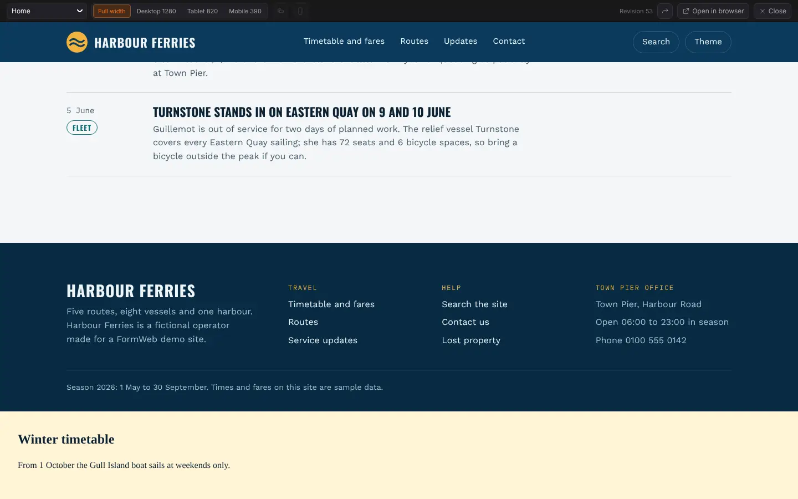
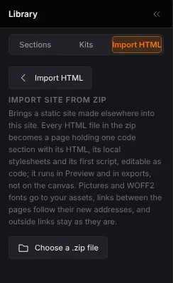
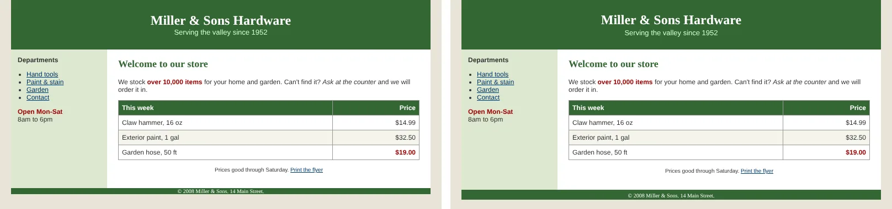

# Importing

You can bring work into FormWeb in four ways: one or several `.html` files as new pages or as a section, pasted HTML code as a section, a whole static site from a zip, or a FormWeb project file.

## Follow along

Pasted HTML is shown on **Harbour Ferries** and Import site from zip on **Coldmere Plumbing** (both under **Help > Demos**). For the files you need one or two `.html` pages of your own; for the zip, a small static site of your own, zipped: a few `.html` files, their CSS and pictures.

## Two ways to bring a page in

Every import asks how the page should arrive, under **Bring it in as** (a section) and **Bring pages in as** (new pages):

- **Editable elements (recommended for editing).** Each heading, paragraph, picture, link, list, table and box becomes an ordinary FormWeb element, the same as one you inserted yourself: you click it on the canvas, double-click to change its text, restyle it in the right panel and drag it to another place. The look is measured at desktop width; responsive rules are not carried over, and scripts and frames stay as small code sections.
- **Code sections (exact copy, edited as code).** The page stays exactly as written, scripts and responsive rules included, and runs in Preview and the export. On the canvas it is one block labelled Code section, which you edit as HTML, CSS and JavaScript in the right panel.


Editable elements is chosen when the view opens. You can also change your mind later: a page brought in as code can be converted at any time (see [Convert a code section to elements](#convert-a-code-section-to-elements) below), and a conversion is one undo step.

## HTML files: Import HTML files

No zip is needed for pages you have as `.html` files.

1. Choose **File > Import HTML files...** (also in the command search, Ctrl+K). The file picker opens at once. Behind it the left panel opens the **Library** at its **Import HTML** view, which has three parts: **HTML files**, **A whole site in a .zip** and **Paste HTML code**. If you close the picker, **Choose .html files...** in the first part opens it again.
2. Pick one `.html` file, or several at once (Ctrl+click or Shift+click in the picker, Cmd+click on a Mac). The view lists the files you chose with their size.
3. Choose how they come in:
   - **As new pages** (the default): each file becomes a page. FormWeb shows the same **Review** as for a zip (see [A whole site](#a-whole-site-import-site-from-zip) below): each page with the address it will get, from its file name (`about.html` becomes `/about`, `index.html` becomes `/`), **Add them** and **Bring pages in as**. Click **Import 1 page**, or **Import 2 pages** and so on. The import is one undo step.
   - **As a section of this page**: offered when you picked exactly one file. The page goes into the open page as one section, after the selected section, with its styles and main script, and its file name as the section's name. Choose **Bring it in as**, then click **Import as section**. The new section is selected and the canvas scrolls to it. With several files picked, this choice is greyed out and the view says that a section takes one file.

A file brings its own `<style>` blocks and its first script. Stylesheets, scripts and pictures it loads from other files are not brought along; for those, zip the site and use Import site from zip. At most 100 files, 64 MiB together, are taken at once, and a file over 1 MiB is skipped with the reason in the review. Choose **Choose other files...** to start again with other files, or the back button **Import HTML** to return to the three parts.

## Pasted code: Paste HTML code

Paste HTML code turns a whole HTML page, with its styles and first script, into a section of the open page: editable elements, or one **code section** that keeps the HTML and CSS as code and runs in Preview and in the export, not on the canvas.

1. Open the **Library** (its icon in the rail, or **Window > Library**) and click its **Import HTML** tab, or choose **File > Import HTML files...** and close the file picker. Scroll to the third part, **Paste HTML code**.

2. Paste the page's HTML in the **HTML** box. In Harbour Ferries, paste this:

   ```html
   <!doctype html><html><head><title>Winter timetable notice</title><style>.notice{padding:32px;background:#fff4d6;font-family:Georgia,serif}.notice h2{margin:0 0 8px}</style></head><body><div class="notice"><h2>Winter timetable</h2><p>From 1 October the Gull Island boat sails at weekends only.</p></div></body></html>
   ```

3. Leave **Section name** empty to use the page's title, or type a name. Under **Bring it in as**, pick **Code sections** to follow the pictures below, or leave **Editable elements** to get elements straight away.


4. Click **Import as section** under the paste part. The status line says "HTML section imported." and the new section, here **Winter timetable notice**, is selected. With the page itself selected, as here, it goes at the end of the page. With **Editable elements** the panel says instead what was converted, for example "Converted 4 elements.", and the notice's heading and paragraph are layers you can click.

On the canvas a code section is drawn as a plain block labelled Code section, because its code does not run there:


5. Open **Preview** to see it working:



Import HTML turns on code sections for the site if they were off. Pictures and scripts that the pasted page loads by a relative path (such as `img/photo.png`) are not brought along: upload them separately, or use Import site from zip.

### A page script

When a code section holds only a script and no HTML, as when a page converted to elements keeps its script, it is a **Page script**. Its layer has a page icon with code brackets, and on the canvas its block reads **Page script**, with "Runs in Preview and on the published site, not on this canvas." under it. Click the block to select it; it gets the orange outline. The right panel then opens the **Content** tab on its **Code section** settings, where you edit the script. A script has no box on the page, so the **Design** and **Motion** tabs only say that their settings do not apply to it, and its right-click menu has no Text style, Background, Spacing or Size. If you were on Design or Motion before, selecting another element takes you back there.

## A whole site: Import site from zip

This brings in a static site built elsewhere: every HTML file becomes a page.

1. Choose **File > Import site from zip...**, or click **Choose a .zip file...** in the **A whole site in a .zip** part of the Import HTML view.
2. The file picker opens; pick your zip. If you close the picker, click **Choose a .zip file** in the view behind it. This picker also takes loose `.html` files, which then come in as described under [HTML files](#html-files-import-html-files).



3. Nothing changes yet. FormWeb shows a **Review** of what it found:
   - the counts, for example "3 pages. 1 asset (42 KiB). 1 stylesheet or script. 1 file is skipped.";
   - **Pages**: each page with its file and the address it will get. `index.html` becomes `/`, `about.html` becomes `/about`, `blog/index.html` becomes `/blog`. When your site already uses an address, the page gets another one and the review says why, for example "/about is taken, so it gets /about-2.";
   - **Add them**: **Add as new pages** (the default), or **Replace matching routes**, which keeps your existing page and its address and swaps its content. Replacing is offered only when nothing else on your site points into that page; otherwise the review says why it is not offered;
   - **Skipped**: each file left out, with the reason.


   - **Bring pages in as**: **Editable elements** (chosen) or **Code sections**, as described above.

4. Click **Import 3 pages** (the button names the count). The status line says "Imported 3 pages and 1 asset. 1 file was skipped." The import is one undo step. With **Editable elements** the pages are then converted, a second undo step, and the panel adds the result, for example:


Undo once and the pages are code sections again; undo twice and the import is gone.

Here is a one-page landing site as written, opened in Chromium at 1440 px, and the same page imported as editable elements, with its heading selected on the canvas and every part of the page listed under Layers:


### What arrives and what is left out

With **Code sections**, each imported page holds one code section, the same kind Import HTML makes (with **Editable elements**, that code section is then converted as described in the next section):

- the page's body as HTML;
- its `<style>` blocks and its local stylesheets as CSS, including the stylesheets they `@import` (stylesheets that import each other in a loop arrive once each, and the review names the loop; imports are followed four levels deep, and the review names any stylesheet left out below that; an `@import` of a stylesheet on another site, such as a web font, is moved to the top of the page's styles, where browsers read it, and the review says it loads from that site);
- its first script, local or inline, as JavaScript.

Pictures (PNG, JPEG, GIF, WebP, SVG), MP4 and WebM videos and WOFF2 fonts go into your site's assets, and every reference to them is updated. Links between the imported pages are changed to their new addresses; links to other websites stay as they are. The page's title and meta description fill its search fields (Page tab, Search & metadata).

Left out, with a note in the review: the rest of the page head, stylesheets and scripts loaded from other websites, scripts after the first one, scripts that are not JavaScript (such as JSON-LD structured data; Import HTML leaves them out the same way), other font formats, icons in ICO format, and any other kind of file.

The zip may be up to 64 MiB and 128 MiB unpacked, with at most 1,000 files and 100 pages. System and dependency folders (`__MACOSX`, `node_modules` and folders whose name starts with a dot) are ignored and do not count toward the 1,000, though the whole zip may hold at most 40,000 entries with them. A zip with a password, links, or files outside its own folder is refused as a whole, and a single top folder is stripped. When a zip is refused for its size or its number of files, the message says what to do: usually, zip only the folder that holds the finished site.

### A project's source is refused

A site made with a build tool has two forms: its source, which a browser cannot show as it is, and the finished site the build writes, often into a folder called `dist` or `build`. A zip of the source is refused with a message, and nothing is imported. FormWeb takes a zip as source when it has a `package.json` at the top (or one folder down) and something only a build can turn into a page: no HTML page at all, source files such as `.ts`, `.tsx`, `.jsx`, `.vue` or `.svelte` in its `src` folder or loaded by a page, a placeholder such as `%PUBLIC_URL%` in a page, or a script that loads a package by its name. The message says which of these it found. Build the project first (usually `npm run build`), then zip the output folder and import that zip. When the zip already holds a built copy in a `dist` or `build` folder, the message names that folder: zip that folder on its own. A finished site that only has a `package.json` beside its pages is imported as usual, and `package.json` is listed as skipped.

## Convert a code section to elements

Any code section that holds plain HTML and CSS, an imported page or one you wrote, can become elements:

1. Right-click it on the canvas or in Layers and choose **Convert to editable elements...**, or click the same button in its **Code section** settings (Content tab), or choose **Edit > Convert to editable elements...**.


2. A short window says what happens. When the section has a script, **Keep the page's script as a code section** is ticked; untick it to leave the script out. Click **Convert**.


3. A notice gives the result, such as "Converted 48 elements. 3 parts stayed as code: a script, an inline frame, a vector graphic. Responsive rules were not carried over. Check it at phone width in Preview, then adjust under each breakpoint.", with an **Undo** button. The last sentence appears whenever the page had responsive rules; [Making it responsive again](#making-it-responsive-again) below says how. The conversion is one undo step, so Ctrl+Z (Cmd+Z on a Mac) brings the code section back exactly.

The section's element stays where it was and takes the page body's look (background, font, colour and spacing); everything inside it becomes its children. When the section is the only thing on its page, as after a site import, the page's padding is set to 0 and the section gets a minimum height of the window when it has a background, so the page fills the window as the original did.

### How a conversion works

FormWeb opens the section's HTML and CSS in a hidden frame inside the editor, lets the browser work out every element's style, and keeps for each element only what differs from what it would have anyway. The hidden frame runs no script and loads nothing from other websites; the only pictures it may load are your site's own assets. What it makes goes to the engine in one batch, so the engine's own checks decide: a value the engine does not take is left out of that element and counted in the result.

### What converts, what stays as code, what is lost

- **Converts:** headings, paragraphs, links (with their address and target), pictures (with their address, alternative text and size), lists, tables (cells keep colspan and rowspan), forms and their fields, buttons, figures, quotes, `<details>`, video and audio, and every box that holds them. Text in a paragraph with bold, italic or a link inside becomes the paragraph's text plus small Text, Bold and Link elements beside it, so each part can be edited. Old tags such as `<font>`, `<center>` and `<u>` become plain text spans and boxes whose look comes from their styles. HTML ids are kept, so links to `#anchors` still work.
- **Styles kept** (base, desktop only): display, flex and grid layout, gaps and alignment, widths and heights, margins and padding, position, fonts, sizes, weights, line height, letter spacing, text alignment and case, colours, background colours and gradients, borders, corner radius, shadows, opacity, overflow, object fit, list style, table spacing and transforms. A self-hosted WOFF2 font the import brought along is added to the site's fonts; any other font keeps its name.
- **Background pictures** that came with the import and fill their box (`background-size: cover` or `contain`), such as a hero photo, become a picture element named Background picture, placed behind the box's content and filling it; a gradient laid over the photo becomes a Background element above it. Click the picture in Layers to replace it.
- **Stays as code, in place:** scripts, inline frames, vector graphics (`<svg>`), embedded objects, canvases and elements FormWeb has no element for (custom elements such as `<my-widget>`). Each becomes a small code section at the spot where it was, with its look written into it, and it runs in Preview and the export as before.
- **Lost, and said in the result:** responsive rules (`@media`), hover and focus styles, `::before` and `::after` decorations, background pictures from other websites, and tiled background pictures (FormWeb's styles do not take pictures; put an image element behind the content instead), floats (FormWeb has no float property), event handlers such as `onclick` and `javascript:` links. Classes are not kept: the look is written on each element.

### Making it responsive again

The conversion writes base (desktop) styles only and never creates breakpoints. To redo what the original did on small screens, pick **Tablet** or **Mobile** from the breakpoint list in the toolbar and change the elements there: for example set the feature row's direction to Column, or the heading's size smaller. Each change is stored for that breakpoint only, as described in [The right panel](04-right-panel.md).

### Large pages

One conversion makes at most 480 elements and follows elements at most 60 levels deep. For a larger page the window lists the page's top-level parts with their size; click **Convert this part** on one of them. That part becomes elements in place, and the parts before and after it stay code sections, with their stylesheet kept to themselves so it does not restyle the new elements. Convert the others the same way. Each part is one undo step.

When you import a whole site as editable elements, every page converts together. A page too large for one conversion stays a code section, and the result says so, for example "1 page was too large to convert at once and stayed a code section: convert it one part at a time with Convert to editable elements."; open that page and convert it part by part as above.

### How close the result is

Five small sites were imported as editable elements and compared at 1440 px with the original opened in Chromium (pixels that differ by more than a trace, as a share of the page):

| Site | Exported page | On the canvas |
| --- | --- | --- |
| One-page landing page (header, hero, three feature columns in a flex row, footer) | 0.0% | 0.0% (plus the thin Page script block of the kept script below the footer) |
| Three pages with a shared stylesheet, a CSS grid gallery of six pictures and links between the pages | 0.0% on each page | 0.0% on each page |
| An old editor's page: tables for layout, inline styles, `<font>` and `<center>` tags | 1.1% | 1.3% |
| A small-business page styled with a CSS framework's classes: navigation bar, hero photo as a CSS background under a dark gradient, three cards, four footer columns | 0.0% | not measured; looks the same |
| A blog article: headings, paragraphs with bold, italic and links, lists, a quote, a picture with a caption, a code block and a table | 0.6% | not measured; looks the same |

At phone width (390 px) the business page and the article do not scroll sideways, but they keep their desktop layout: cards stay side by side and type keeps its desktop size, because responsive rules are not carried over. See [Making it responsive again](#making-it-responsive-again).

The old page's difference is in line heights: pages with an old HTML 4 doctype are drawn in the browser's "almost standards" mode, where a line of small text in a table cell is shorter, and FormWeb pages always use the standard mode. The title band and the footer band are a few pixels taller, nothing moves sideways:



## FormWeb projects: .fweb and .fpub

**File > Import .fweb or .fpub file...** opens a project file. It replaces the open site, so save your work first.

- A `.fweb` file is a FormWeb project, as made by **File > Download .fweb project**. It opens with all its pages, pictures and history. For example, `site.fweb` from a demo folder opens as that demo; the status line says Imported "site.fweb".
- A `.fpub` file is the package FormPublisher saves for a site build. FormWeb checks the package and opens the FormWeb site inside it. It does not check the package's signature; FormPublisher does that when it opens the same file. A `.fpub` of a site that was not made in FormWeb is refused, with a message pointing to FormPublisher.

In the desktop app you can also double-click a `.fweb` or `.fpub` file to open it.

## Next

[Components and the Library](10-components-and-library.md).
