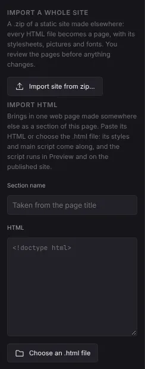
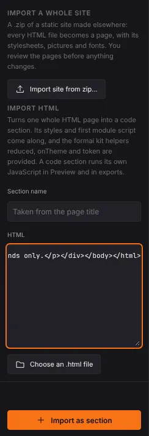
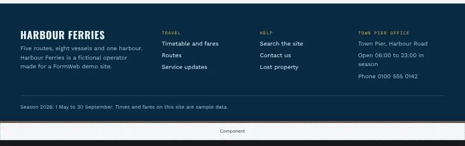

# Importing

You can bring work into FormWeb in three ways: one HTML page as a section, a whole static site from a zip, or a FormWeb project file.

## Follow along

Import HTML is shown on **Harbour Ferries** and Import site from zip on **Coldmere Plumbing** (both under **Help > Demos**). For the zip you need a small static site of your own, zipped: a few `.html` files, their CSS and pictures.

## One page: Import HTML

Import HTML turns a whole HTML page, with its styles and first script, into one **code section** on the open page. A code section keeps the HTML and CSS as code you can edit, and it runs in Preview and in the export, not on the canvas.

1. Choose **File > Import HTML...**. The left panel opens the **Library** at its **Import HTML** view.



2. Paste the page's HTML in the **HTML** box, or click **Choose an .html file**. In Harbour Ferries, paste this:

   ```html
   <!doctype html><html><head><title>Winter timetable notice</title><style>.notice{padding:32px;background:#fff4d6;font-family:Georgia,serif}.notice h2{margin:0 0 8px}</style></head><body><div class="notice"><h2>Winter timetable</h2><p>From 1 October the Gull Island boat sails at weekends only.</p></div></body></html>
   ```

3. Leave **Section name** empty to use the page's title, or type a name.



4. Click **Import as section** at the bottom of the panel. The status line says "HTML section imported." and the new section, here **Winter timetable notice**, is selected. With the page itself selected, as here, it goes at the end of the page.

On the canvas a code section is drawn as a plain strip labelled Component, because its code does not run there:



5. Open **Preview** to see it working:


Import HTML turns on code sections for the site if they were off. Pictures and scripts that the pasted page loads by a relative path (such as `img/photo.png`) are not brought along: upload them separately, or use Import site from zip.

## A whole site: Import site from zip

This brings in a static site built elsewhere: every HTML file becomes a page.

1. Choose **File > Import site from zip...**, or click **Import site from zip...** at the top of the Import HTML view.
2. Click **Choose a .zip file** and pick your zip.


3. Nothing changes yet. FormWeb shows a **Review** of what it found:
   - the counts, for example "3 pages. 1 asset (42 KiB). 1 stylesheet or script. 1 file is skipped.";
   - **Pages**: each page with its file and the address it will get. `index.html` becomes `/`, `about.html` becomes `/about`, `blog/index.html` becomes `/blog`. When your site already uses an address, the page gets another one and the review says why, for example "/about is taken, so it gets /about-2.";
   - **Add them**: **Add as new pages** (the default), or **Replace matching routes**, which keeps your existing page and its address and swaps its content. Replacing is offered only when nothing else on your site points into that page; otherwise the review says why it is not offered;
   - **Skipped**: each file left out, with the reason.


4. Click **Import 3 pages** (the button names the count). The status line says "Imported 3 pages and 1 asset. 1 file was skipped." The whole import is one undo step.

### What arrives and what is left out

Each imported page holds one code section, the same kind Import HTML makes:

- the page's body as HTML;
- its `<style>` blocks and its local stylesheets as CSS;
- its first script, local or inline, as JavaScript.

Pictures (PNG, JPEG, GIF, WebP, SVG), MP4 and WebM videos and WOFF2 fonts go into your site's assets, and every reference to them is updated. Links between the imported pages are changed to their new addresses; links to other websites stay as they are. The page's title and meta description fill its search fields (Page tab, Search & metadata).

Left out, with a note in the review: the rest of the page head, stylesheets and scripts loaded from other websites, scripts after the first one, other font formats, icons in ICO format, and any other kind of file.

The zip may be up to 64 MiB, with at most 1,000 files and 100 pages. A zip with a password, links, or files outside its own folder is refused as a whole. System files such as `__MACOSX` folders are ignored, and a single top folder is stripped.

## FormWeb projects: .fweb and .fpub

**File > Import .fweb or .fpub file...** opens a project file. It replaces the open site, so save your work first.

- A `.fweb` file is a FormWeb project, as made by **File > Download .fweb project**. It opens with all its pages, pictures and history. For example, `site.fweb` from a demo folder opens as that demo; the status line says Imported "site.fweb".
- A `.fpub` file is the package FormPublisher saves for a site build. FormWeb checks the package and opens the FormWeb site inside it. It does not check the package's signature; FormPublisher does that when it opens the same file. A `.fpub` of a site that was not made in FormWeb is refused, with a message pointing to FormPublisher.

In the desktop app you can also double-click a `.fweb` or `.fpub` file to open it.

## Next

[Components and the Library](10-components-and-library.md).
