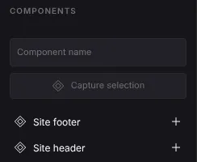
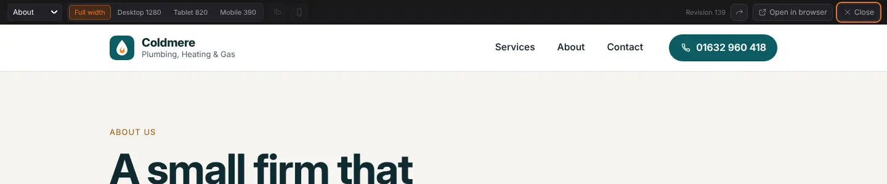
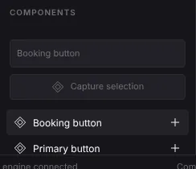
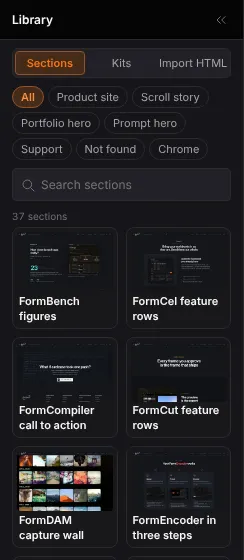
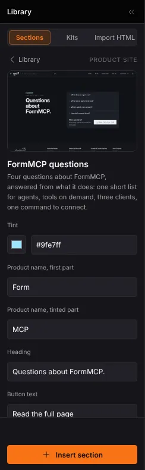

# Components and the Library

Two things save you from building the same part twice: **components**, which you make from your own work and reuse, and the **Library**, which holds ready-made sections and design kits.

## Follow along

The component example uses **Coldmere Plumbing** and the Library example **Looking Back** (both under **Help > Demos**).

## Components

A component is a part you build once and place many times, for example a header, a footer or a styled button. Each placed copy is an **instance** linked to the original: change the original and every instance changes with it.

### See linked components in Coldmere

The five whole-site demos (Coldmere Plumbing, Northfold Studio, The Slow Allotment, Wenlow Type Day and Fernhollow Pottery) share their header and footer as two components, **Site header** and **Site footer**.

1. Open the **Insert** panel: click the **+** icon in the rail on the far left (or choose **Insert > Elements and components**). Scroll to **COMPONENTS** at the bottom.

2. On the Home page, double-click the words Plumbing & Heating under Coldmere in the header, type `Plumbing, Heating & Gas`, and click outside the text.
3. Open **Preview**, and pick **About** in the page list. The About page shows the new words too, because its header is an instance of the same component.

In the Layers list of the other pages, the header's row says **instance**. Inside an instance you cannot move, delete or add elements; those menu items are greyed out and their tooltip says why. Change the original instead.

### Make your own component

1. Select the element you want to reuse, for example a button. (You cannot capture the page itself.)
2. In the Insert panel, type a name in **Component name**, for example `Booking button`.
3. Click **Capture selection**. The status line says Component "Booking button" captured. Insert an instance from the list.
4. To place it, select where it should go and click its name in the components list. The status line says "Component instance inserted."

Components can also have properties, variants and slots, set up in **Window > Website studio...** under Components & libraries. The [manual](../MANUAL.md#components-and-tokens) describes them.

## The Library

The Library holds finished sections you can drop into any site, design presets, and starter sites. Open it with the **Library** icon in the rail (the third icon) or **Window > Library**. It has three views: **Sections**, **Kits** and **Import HTML** (see [Importing](09-importing.md)).

### Insert a library section

1. In the Library, click **Sections**. The category chips (All, Product site, Scroll story, Portfolio hero, Prompt hero, Support, Not found, Chrome) and the search field narrow the list.

2. Click a card. Its detail opens: a larger picture, what it is, and the fields you can fill in before inserting (a tint color, names, the heading, the button text and so on).

3. Click **Insert section**. In Looking Back the status line says "Inserted FormMCP questions." The section goes after the selected top-level section, or at the end of the page, as one undo step.

An inserted section uses your site's own colors and text styles where it can, and adds only what your site is missing, so it never overwrites your own values.

**Kits** lists design presets (**Apply preset** sets every value the preset defines) and starters (**Use starter** asks for a product name and a tint, then adds the starter's pages).

The [library guide](../LIBRARY.md) explains how sections and page components are made, and how to add your own.

## Next

[Keyboard shortcuts](11-keyboard-shortcuts.md).
