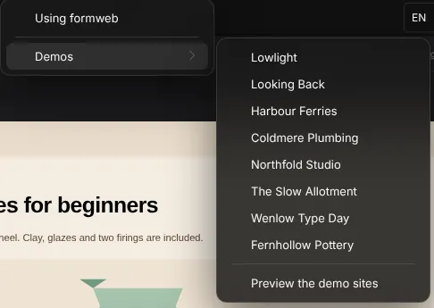
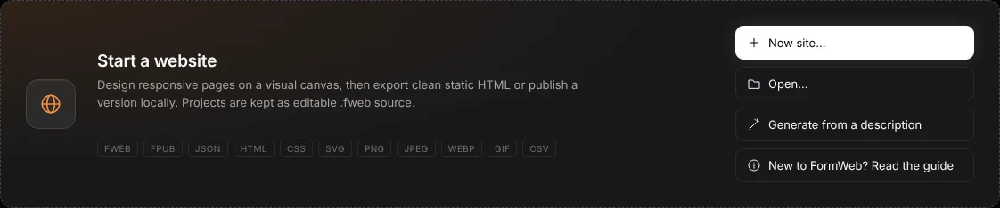

# FormWeb user guide: start here

This guide is for you if you have never used FormWeb. It shows, step by step, how to build a website with it. Every step was done in the app, and every picture is a screenshot of the app.

## What FormWeb is

FormWeb is a visual website builder: you place sections, text, pictures and buttons on a page and style them, and you see the page as you work. It runs on your own computer, needs no account, and keeps your work as an editable project file (`.fweb`). When the site is ready, FormWeb exports it as plain HTML, CSS and JavaScript in a zip file that any web host can serve.

## A map of the window

The blue frames and numbers were added to the screenshot for this guide. They are not part of the app.

1. **Top bar.** The first row has the menus (File, Edit, View, Insert, Page, Arrange, Vector, CMS, Window, Help), Undo and Redo, a workspace picker, **Preview** and **Publish**. The second row has the site name, the Desktop, Tablet and Mobile buttons with the breakpoint list and the width box, the language list, **Export** and **Audit**.
2. **Left panel.** The narrow column of icons on the far left is the rail: it switches the left panel between Pages and layers, Insert, Library, Design system and more. With Pages and layers chosen you see the **PAGES** list (every page of the site) and the **LAYERS** list (everything on the open page, as a tree).
3. **Canvas.** The open page, drawn at the width of the breakpoint you picked. Click anything on it to select it. The bar above it shows the selection path, for example Home / Page / Hm main / Hm hero.
4. **Right panel.** Everything about the selected element: the **Design**, **Motion**, **Content** and **Page** tabs, and the **Search properties** field that finds any setting by name.

The line at the very bottom of the window is the status line. FormWeb writes there what it just did, for example "Section inserted. The operation is one undo step."

## Follow along with a demo

FormWeb comes with eight finished demo sites. Most pages of this guide use one of them for a worked example, so you can repeat each step yourself.

To open a demo, use either way:

- Open **Help > Demos** and pick the demo by name.
- Or open Home (**File > Home**, or click the formweb mark at the top left) and click a demo card in the **Demos** row.

A demo opens as a new site that is not saved yet. Your saved projects are not touched. If you want to keep what you change, save it with **File > Save**.

## The guide

1. [Your first site](01-first-site.md): from an empty page to an exported zip, every step pictured. Start here.
2. [Pages and layers](02-pages-and-layers.md): add, rename, reorder and fold pages and layers, set the home page, select several layers at once.
3. [Working on the canvas](03-canvas.md): select, the right-click menu, drag to move, hover outlines, wrap in a container, copy and paste styles.
4. [The right panel](04-right-panel.md): the tabs, sliders, the color picker and gradients, the grid layout chooser, Search properties, and editing a breakpoint.
5. [Page background and theme colors](05-background-and-theme-colors.md): why a new page is white, the site background every page can share, starting a page with the home page's background, matching another page, one page or all pages, the site's theme colors.
6. [Preview](06-preview.md): Preview as published, and the Live responsive preview on the canvas.
7. [Audit](07-audit.md): what the audit checks and how Select takes you to the problem.
8. [Export and publishing](08-export-and-publish.md): the zip file, where it goes, and Send to FormPublisher.
9. [Importing](09-importing.md): HTML files as pages or a section, pasted HTML, a whole site from a zip, and .fweb and .fpub files.
10. [Components and the Library](10-components-and-library.md): reusable parts and ready-made sections.
11. [Keyboard shortcuts](11-keyboard-shortcuts.md): every shortcut the app registers.
12. [Coming from Dreamweaver or another visual builder](12-coming-from-other-builders.md): where to find the things you already know.

## More help

- In the app, the Start screen (**File > Home**) has **New to FormWeb? Read the guide** under New site, Open and Generate from a description. It opens this guide in your browser.

- **Help > Using FormWeb** gives a one-screen summary and a button that opens this guide.
- The [manual](../MANUAL.md) describes every feature in detail. Use it when you need the exact rules.
- The [library guide](../LIBRARY.md) explains how library sections and page components are made.
